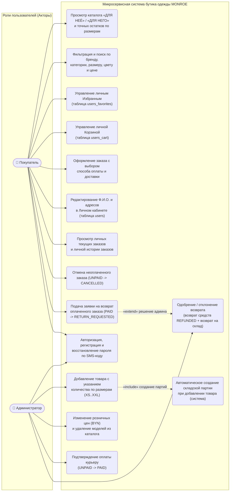
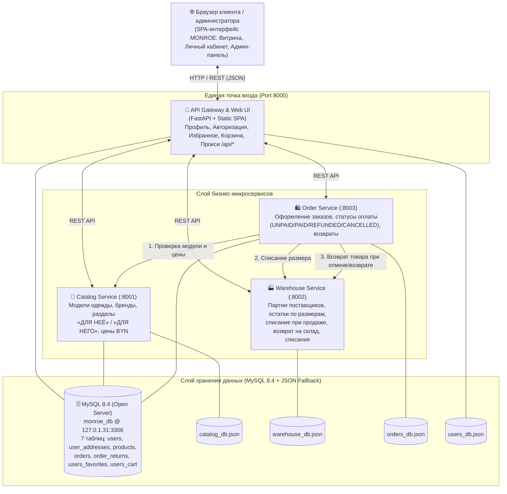
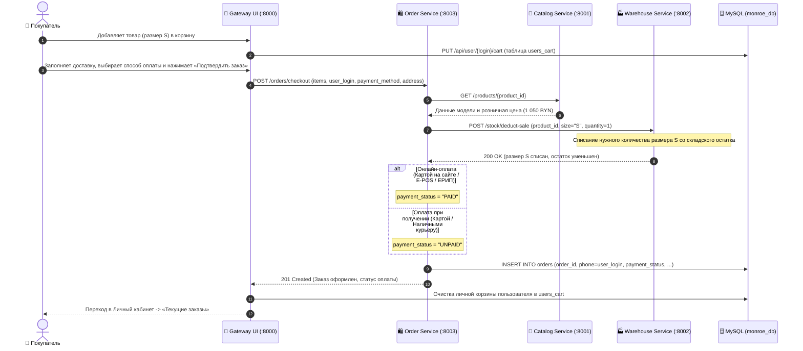
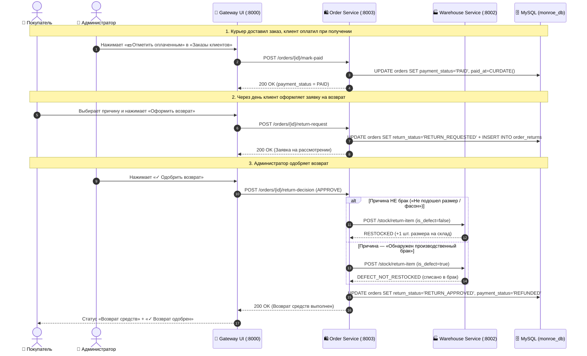
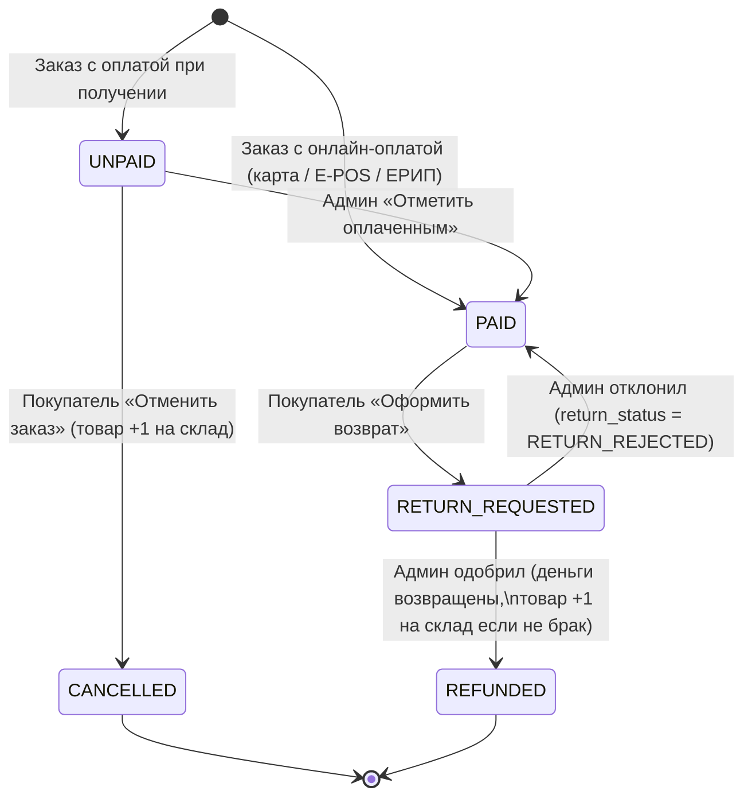
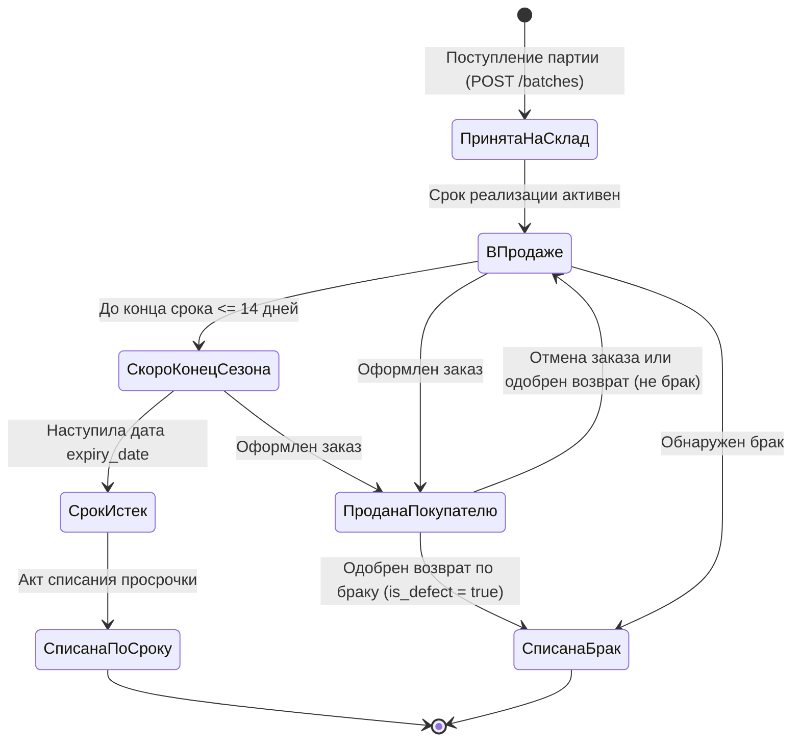
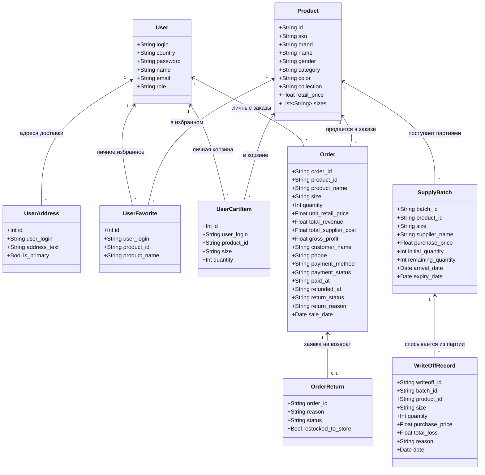

#  MONROE — Микросервисная система управления бутиком брендовой одежды и интернет-магазином

Веб-приложение на базе **микросервисной архитектуры** (4 независимых сервиса на Python FastAPI + MySQL 8.4) для автоматизации работы мультибрендового бутика дизайнерской одежды **MONROE** (Республика Беларусь, цены в **BYN**):
* витрина с женским (**«ДЛЯ НЕЁ»**) и мужским (**«ДЛЯ НЕГО»**) разделами, фильтрацией и отображением **точных остатков по каждому размеру** (`XS`, `S`, `M`, `L`, `XL`, `XXL`);
* **персональная Корзина (`users_cart`)**, **персональное Избранное (`users_favorites`)**, **личная история заказов** и редактирование **Ф.И.О.** с сохранением в БД и приветствием `«Здравствуйте, <Ф.И.О.>»`;
* складской учет: партии товаров создаются автоматически при добавлении модели администратором, на витрине отображаются точные остатки каждого размера, при продаже остаток списывается, а при отмене или возврате товар возвращается на склад;
* честная модель оплаты и возвратов: разделение статусов **«Оплачен» (`PAID`)** для онлайн-оплаты и **«Ожидает оплаты» (`UNPAID`)** для оплаты курьеру при получении, подтверждение оплаты администратором, отмена неоплаченных заказов (`CANCELLED`) и возврат оплаченных заказов с возвратом средств (`REFUNDED`) и автоматическим возвратом качественного товара на склад (`+1` к размеру);
* панель администратора с добавлением новых моделей и указанием **точного количества единиц по каждому размеру**, управлением ценами и заказами клиентов.

> 📄 Полная академическая спецификация бизнес-требований, сценариев использования (Use Cases), анализа рисков и UML-моделирования также оформлена в файле **[`docs/BUSINESS_REQUIREMENTS.md`](docs/BUSINESS_REQUIREMENTS.md)**.

---

## 📋 Содержание
1. [Бизнес-требования и описание предметной области](#-1-бизнес-требования-и-описание-предметной-области)
2. [Функциональные и нефункциональные требования](#-2-функциональные-и-нефункциональные-требования)
3. [Анализ рисков и матрица управления рисками](#-3-анализ-рисков-и-матрица-управления-рисками)
4. [UML-моделирование системы (7 диаграмм Mermaid)](#-4-uml-моделирование-системы)
   - [4.1. Диаграмма вариантов использования (Use Case Diagram)](#41-uml-диаграмма-вариантов-использования-use-case-diagram)
   - [4.2. Диаграмма микросервисной архитектуры (Component Diagram)](#42-диаграмма-микросервисной-архитектуры-component-diagram)
   - [4.3. Диаграмма последовательности: оформление заказа и списание остатков (Sequence Diagram)](#43-uml-диаграмма-последовательности-sequence-diagram-оформление-заказа-и-списание-остатков)
   - [4.4. Диаграмма последовательности: оплата курьеру, возврат товара и возврат средств (Sequence Diagram)](#44-uml-диаграмма-последовательности-sequence-diagram-оплата-курьеру-возврат-и-возврат-средств)
   - [4.5. Диаграмма состояний заказа (Statechart Diagram — Order Lifecycle)](#45-uml-диаграмма-состояний-заказа-statechart-diagram--order-lifecycle)
   - [4.6. Диаграмма состояний единицы товара в партии (Statechart Diagram — Stock Item)](#46-uml-диаграмма-состояний-единицы-товара-в-партии-statechart-diagram--stock-item)
   - [4.7. Диаграмма классов предметной области и сущностей БД (Class Diagram)](#47-uml-диаграмма-классов-предметной-области-class-diagram)
5. [Описание микросервисов и схема БД MySQL (`monroe_db`)](#-5-описание-микросервисов-и-схема-бд-mysql-monroe_db)
6. [Быстрый запуск проекта и тестовые аккаунты](#-6-быстрый-запуск-проекта-и-тестовые-аккаунты)

---

## 🎯 1. Бизнес-требования и описание предметной области

### 1.1. Проблематика бизнеса
Мультибрендовый бутик одежды (**MONROE**, Беларусь, расчеты в **BYN**) закупает коллекции дизайнерских брендов (*PATRIZIA PEPE*, *GIUSEPPE DI MORABITO* и др.) партиями у нескольких европейских поставщиков и дистрибьюторов. В работе бутика возникают 4 ключевые бизнес-проблемы:
1. **Учет остатков по каждому размеру:** и покупатель на витрине, и администратор должны видеть точное количество единиц по каждому размеру (`XS`, `S`, `M`, `L`, `XL`, `XXL`).
2. **Разделение способа оплаты и факта оплаты:** оплата «Онлайн картой на сайте» / E-POS / ЕРИП дает статус **`PAID` (Оплачен)** сразу, тогда как «Картой / наличными при получении» означает статус **`UNPAID` (Ожидает оплаты)** до тех пор, пока курьер не передаст оплату и администратор не подтвердит её.
3. **Разделение отмены и возврата:** неоплаченный заказ (`UNPAID`) можно только **отменить** (`CANCELLED`, товар возвращается на склад без движения денег). Оплаченный заказ (`PAID`) можно **вернуть** по заявке (`RETURN_REQUESTED`): при одобрении администратором клиенту возвращаются деньги (`REFUNDED`), а качественный товар возвращается в продажу (`+1` к размеру; брак списывается и на витрину не возвращается).
4. **Персонализация данных клиентов:** у каждого покупателя должны быть собственные Ф.И.О. в профиле и приветствии, собственная корзина (`users_cart`), собственное избранное (`users_favorites`) и только своя история заказов.

### 1.2. Роли пользователей (Акторы)
* **Покупатель (Клиент):** просматривает разделы «ДЛЯ НЕЁ» / «ДЛЯ НЕГО», фильтрует каталог, видит остатки по размерам, пользуется личным Избранным и личной Корзиной, редактирует Ф.И.О. и адреса доставки, оформляет заказы, отменяет неоплаченные заказы и подает заявки на возврат оплаченных заказов. Видит только свои заказы.
* **Администратор:** управляет каталогом (добавление новых товаров с указанием количества штук по каждому размеру `XS`–`XXL`, изменение цен в BYN, удаление моделей) и заказами всех клиентов (подтверждение оплаты при получении «💵 Отметить оплаченным», одобрение или отклонение заявок на возврат).

> ⚙️ В системе только **2 роли**. Отдельной роли «Кладовщик» нет: складские операции (создание партий при добавлении товара, списание остатка при заказе, возврат товара на склад) выполняются микросервисами автоматически.

---

## ⚙️ 2. Функциональные и нефункциональные требования

### 2.1. Функциональные требования (FR)
* **FR-01. Каталог и витрина:** разделы «ДЛЯ НЕЁ» и «ДЛЯ НЕГО» с гендерно-зависимыми категориями одежды и аксессуаров, размерными сетками, фильтрацией по бренду/цвету/размеру/цене, сортировкой и поиском.
* **FR-02. Персональная Корзина и Избранное в MySQL:** хранение корзины каждого пользователя в таблице `users_cart` (`GET/PUT /api/user/{login}/cart`) и избранного в таблице `users_favorites` (`GET/POST/DELETE /api/user/{login}/favorites*`).
* **FR-03. Личный кабинет и профиль пользователя:** авторизация и регистрация по номеру телефона, восстановление пароля через SMS-код, сохранение Ф.И.О. в таблицу `users` MySQL (`POST /api/auth/update-profile`) и приветствие пользователя по Ф.И.О. (`«Здравствуйте, Олег»`).
* **FR-04. Статусы оплаты заказа:**
  * онлайн-способы оплаты («Онлайн картой на сайте», E-POS, ЕРИП) → `payment_status = PAID`;
  * оплата при получении («Картой при получении», «Наличными при получении») → `payment_status = UNPAID` с последующим подтверждением администратором (`POST /orders/{id}/mark-paid`).
* **FR-05. Отмена и возврат заказов:**
  * отмена неоплаченного заказа покупателем (`POST /orders/{id}/cancel`) → `CANCELLED` + возврат размера на склад;
  * заявка на возврат оплаченного заказа (`POST /orders/{id}/return-request`) и решение администратора (`POST /orders/{id}/return-decision`) → при одобрении `payment_status = REFUNDED`, качественный товар возвращается на склад (`+1`), брак списывается.
* **FR-06. Изоляция истории заказов:** покупатель видит во вкладках «Текущие заказы» и «История заказов» только свои заказы; администратор во вкладке «Заказы клиентов» видит заказы всех покупателей.
* **FR-07. Панель администратора с вводом остатков по размерам:** добавление товара с указанием количества единиц по размерам `XS`, `S`, `M`, `L`, `XL`, `XXL` (автоматическое создание партий на складе), изменение цен и удаление товаров.

### 2.2. Нефункциональные требования (NFR)
* **NFR-01. Микросервисная архитектура:** 4 независимых сервиса (`Gateway :8000`, `Catalog :8001`, `Warehouse :8002`, `Order :8003`), взаимодействующих по HTTP/REST.
* **NFR-02. Хранение данных (MySQL 8.4 + JSON Fallback):** основная СУБД — **MySQL 8.4** (Open Server, `127.0.1.31:3306`, база `monroe_db`, 7 таблиц) с автоматическим резервированием в JSON-файлы.
* **NFR-03. Мониторинг здоровья (Health-check):** верхняя панель сайта в реальном времени опрашивает `/api/system-status` и отображает статус всех микросервисов и подключения к MySQL.

---

## ⚠️ 3. Анализ рисков и матрица управления рисками

| ID | Категория | Описание риска | Вероятность | Влияние | Меры минимизации (Mitigation) в системе |
|:---:|:---|:---|:---:|:---:|:---|
| **R-01** | Бизнес / Склад | **Продажа отсутствующего размера (Overselling):** оформление заказа на закончившийся размер. | Средняя | Высокое | Синхронная проверка и атомарное списание размера в `Warehouse Service` перед подтверждением заказа. |
| **R-02** | Бизнес / Финансы | **Возврат денег по неоплаченному заказу:** попытка оформить возврат до фактической оплаты курьеру. | Средняя | Среднее | Возврат (`return-request`) разрешен строго для `PAID`; для `UNPAID` доступна только отмена (`CANCELLED`) без возврата денег. |
| **R-03** | Бизнес / Склад | **Потеря товара при возврате или попадание брака обратно на витрину.** | Средняя | Высокое | Эндпоинт `POST /stock/return-item` возвращает `+1` на склад только при `is_defect = false`; брак не возвращается в продажу. |
| **R-04** | Безопасность / Данные | **Смешивание корзин, избранного и истории заказов разных пользователей.** | Средняя | Высокое | Персональные таблицы `users_cart` и `users_favorites` в MySQL, фильтрация заказов по логину/телефону пользователя, изоляция ключей `localStorage`. |
| **R-05** | Технический | **Отказ отдельного микросервиса или остановка MySQL в Open Server.** | Средняя | Среднее | Изоляция процессов, таймауты HTTP-запросов, health-check панель в шапке сайта и автоматический JSON-fallback. |

---

## 📊 4. UML-моделирование системы

### 4.1. UML-диаграмма вариантов использования (Use Case Diagram)



---

### 4.2. Диаграмма микросервисной архитектуры (Component Diagram)



---

### 4.3. UML-диаграмма последовательности (Sequence Diagram): Оформление заказа и списание остатков



---

### 4.4. UML-диаграмма последовательности (Sequence Diagram): Оплата курьеру, возврат и возврат средств



---

### 4.5. UML-диаграмма состояний заказа (Statechart Diagram — Order Lifecycle)



---

### 4.6. UML-диаграмма состояний единицы товара в партии (Statechart Diagram — Stock Item)



---

### 4.7. UML-диаграмма классов предметной области (Class Diagram)



---

## 🧩 5. Описание микросервисов и схема БД MySQL (`monroe_db`)

### 5.1. Микросервисы

| Сервис | Порт | Папка | Назначение и ключевые эндпоинты |
|:---|:---:|:---|:---|
| **Gateway & Frontend** | `8000` | `gateway_frontend/` | Веб-интерфейс бутика и админ-панели, авторизация и сохранение Ф.И.О. (`/api/auth/update-profile`, `/api/user/{login}/profile`), персональное избранное (`/api/user/{login}/favorites*`), персональная корзина (`/api/user/{login}/cart`), мониторинг сервисов (`/api/system-status`). |
| **Catalog Service** | `8001` | `services/catalog_service/` | Управление моделями одежды, брендами, разделами («ДЛЯ НЕЁ» / «ДЛЯ НЕГО»), категориями и ценами (`GET/POST /products`, `PATCH/DELETE /products/{id}`). |
| **Warehouse Service** | `8002` | `services/warehouse_service/` | Приход партий по размерам (`POST /batches`), остатки по размерам (`GET /stock/summary`), списание остатка при продаже (`POST /stock/deduct-sale`), возврат товара на склад при отмене/возврате (`POST /stock/return-item`), списания (`POST /writeoffs`), истекающие партии (`GET /alerts/expiring`). |
| **Order Service** | `8003` | `services/order_service/` | Оформление заказов (`POST /orders/checkout`) со статусами оплаты (`UNPAID`/`PAID`/`REFUNDED`/`CANCELLED`), подтверждение оплаты при получении (`POST /orders/{id}/mark-paid`), отмена неоплаченного заказа (`POST /orders/{id}/cancel`), заявки и решения по возврату (`POST /orders/{id}/return-request`, `POST /orders/{id}/return-decision`). |

### 5.2. Таблицы базы данных `monroe_db` (MySQL 8.4)
SQL-скрипт для **DBeaver**: [`database/monroe_mysql.sql`](database/monroe_mysql.sql)

1. **`users`** — пользователи и администраторы (`login`, `password`, `name` — Ф.И.О., `email`, `role`).
2. **`user_addresses`** — адреса доставки покупателей (`user_login`, `address_text`, `is_primary`).
3. **`products`** — каталог товаров бутика с ценами в BYN и JSON-остатками по размерам.
4. **`orders`** — заказы с привязкой к клиенту (`phone`), себестоимостью проданного товара, статусом оплаты (`payment_status`, `paid_at`, `refunded_at`) и статусом возврата (`return_status`, `return_reason`).
5. **`order_returns`** — реестр заявок на возврат и решений администратора (`restocked_to_store`).
6. **`users_favorites`** — персональное избранное каждого покупателя (`user_login`, `product_id`).
7. **`users_cart`** — персональная корзина каждого покупателя (`user_login`, `product_id`, `size`, `quantity`).

---

## 🚀 6. Быстрый запуск проекта и тестовые аккаунты

### Вариант 1. Запуск одной командой на Windows / macOS / Linux (Рекомендуется)
1. Установите зависимости:
   ```bash
   pip install -r requirements.txt
   ```
2. Запустите все 4 микросервиса одним скриптом:
   ```bash
   python run_all.py
   ```
   *(На Windows также можно дважды кликнуть по файлу **`start.bat`**).*
3. Откройте в браузере:
   * **Веб-приложение бутика MONROE:** [http://localhost:8000](http://localhost:8000)
   * **Swagger UI (Catalog Service):** [http://localhost:8001/docs](http://localhost:8001/docs)
   * **Swagger UI (Warehouse Service):** [http://localhost:8002/docs](http://localhost:8002/docs)
   * **Swagger UI (Order Service):** [http://localhost:8003/docs](http://localhost:8003/docs)

### Подключение MySQL 8.4 (Open Server + DBeaver)
* **Хост:** `127.0.1.31` | **Порт:** `3306` | **Пользователь:** `root` | **Пароль:** *(пустой)* | **База:** `monroe_db`

### Тестовые аккаунты
| Роль | Логин (телефон) | Пароль | Имя в профиле |
|:---|:---|:---|:---|
| Покупатель 1 | `375445658384` | `123` | Анна Ковалева |
| Покупатель 2 | `375447573540` | `123` | Олег |
| Администратор | `375291111111` (или `admin`) | `admin123` | Администратор MONROE |

### Вариант 2. Запуск в контейнерах Docker Compose
```bash
docker-compose up --build
```
