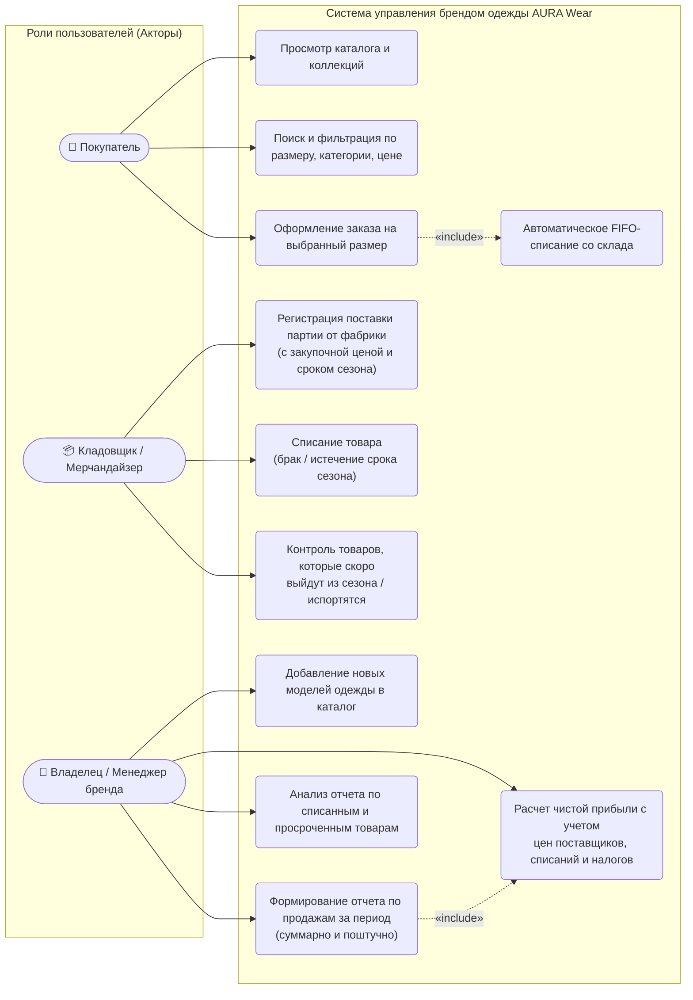
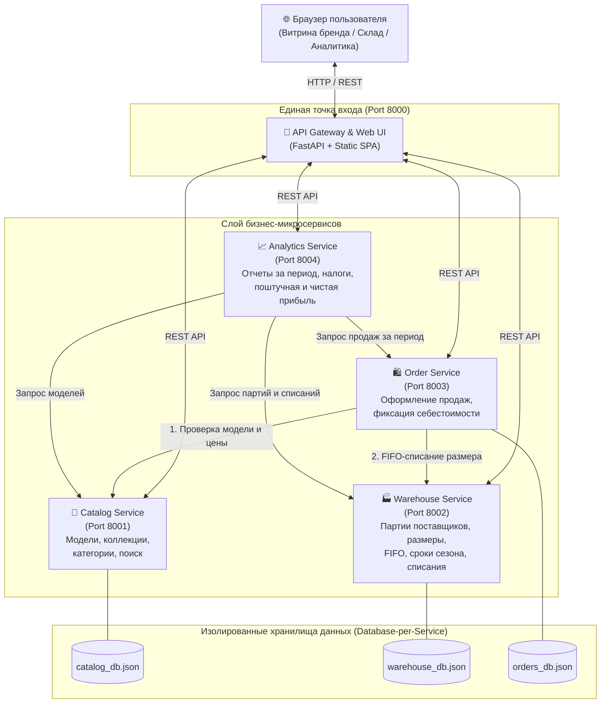
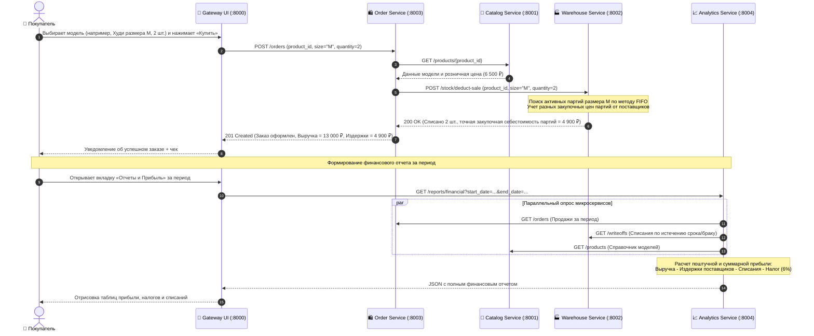
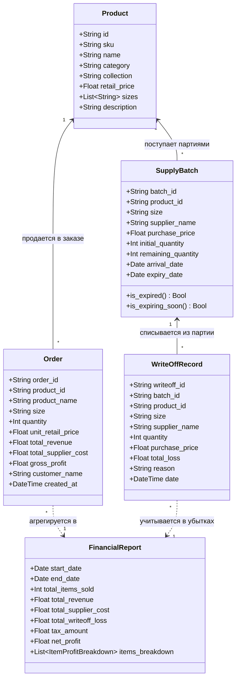

# 🧥 AURA Wear — Микросервисная система управления брендом одежды и интернет-магазином

Веб-приложение на базе **микросервисной архитектуры** для автоматизации работы бренда одежды: управление каталогом и капсульными коллекциями, складской учет партий пошива от разных фабрик/поставщиков по различным закупочным ценам, контроль сроков сезонной реализации и списаний (брак / истечение сезона), оформление заказов по размерам и расчет чистой прибыли с учетом себестоимости партий и налогов.

---

## 📋 Содержание
1. [Бизнес-требования и описание предметной области](#-1-бизнес-требования-и-описание-предметной-области)
2. [Функциональные и нефункциональные требования](#-2-функциональные-и-нефункциональные-требования)
3. [Анализ рисков и матрица рисков](#-3-анализ-рисков-и-матрица-рисков)
4. [UML-диаграммы (Use Case, Архитектура, Sequence, Class)](#-4-uml-диаграммы)
5. [Описание микросервисов](#-5-описание-микросервисов)
6. [Быстрый запуск проекта](#-6-быстрый-запуск-проекта)

*(Полная версия спецификации также продублирована в файле [`docs/BUSINESS_REQUIREMENTS.md`](docs/BUSINESS_REQUIREMENTS.md)).*

---

## 🎯 1. Бизнес-требования и описание предметной области

### 1.1. Проблематика
Современный бренд одежды (**AURA Wear**) работает с несколькими швейными фабриками и поставщиками тканей/изделий. Одна и та же модель одежды (например, *Оверсайз худи Heavy Cotton* размера `M` или `L`) в разных партиях поставки имеет **разную закупочную цену (себестоимость)** из-за колебаний цен на ткань, курса валют и срочности пошива.  
Кроме того, одежда в fashion-индустрии имеет **срок сезонной реализации (срок годности коллекции / дропа)**: по окончании сезона нераспроданные остатки теряют актуальность, требуют уценки или списываются (как неликвид или производственный брак при инвентаризации).

### 1.2. Цель проекта
Создать автоматизированную микросервисную систему, которая объединяет витрину интернет-магазина, партионный складской учет (приход и списание по методу FIFO) и финансовую аналитику для точного расчета поштучной и суммарной прибыли с учетом закупочных издержек и налогов.

### 1.3. Роли пользователей (Акторы)
* **Покупатель (Клиент):** просматривает каталог бренда, ищет вещи по названию, коллекции, категории, размеру и цене, оформляет заказы.
* **Кладовщик / Мерчандайзер:** регистрирует поступление новых партий одежды от фабрик-поставщиков (с указанием размера, закупочной цены и даты окончания сезона), отслеживает вещи, у которых скоро истекает срок сезонной реализации, выполняет списание брака и просроченных сезонных остатков.
* **Владелец бренда / Финансовый менеджер:** управляет моделями каталога и формирует отчеты за период по продажам, списаниям, издержкам на закупку у поставщиков, налогам и чистой прибыли.

---

## ⚙️ 2. Функциональные и нефункциональные требования

### 2.1. Функциональные требования (FR)
* **FR-1. Управление каталогом и поиск:**
  * Хранение карточек моделей одежды с разделением по категориям (*Худи и свитшоты*, *Футболки*, *Брюки и деним*, *Верхняя одежда*, *Аксессуары*), коллекциям (*SS26 Street*, *Basic Capsule*, *Limited Drop*) и размерной сетке (`XS`, `S`, `M`, `L`, `XL`).
  * Поиск и фильтрация по названию модели, коллекции, категории, размеру и цене.
* **FR-2. Партионный складской учет (Поступление):**
  * Приемка товара партиями от различных швейных фабрик/поставщиков.
  * Каждая партия фиксирует: модель, размер, поставщика, количество штук, **закупочную цену за единицу**, дату поступления и **срок окончания сезонной годности/реализации**.
* **FR-3. Продажа и списание товара:**
  * При продаже единицы одежды нужного размера система автоматически списывает ее из самой ранней доступной партии (**метод FIFO**) и фиксирует реальную закупочную цену именно этой партии для точного расчета прибыли.
  * Ручное и автоматическое списание единиц товара по причинам: **истечение срока сезонной реализации (просрочка коллекции)** или **производственный брак / порча**.
* **FR-4. Контроль истекающих сроков (Уведомления о рисках неликвида):**
  * Вывод отдельного списка партий товаров с已经 истекшим сроком реализации и списка товаров, которые **скоро выйдут из сезона (осталось ≤ 14 дней)**, для своевременного проведения распродажи.
* **FR-5. Финансовая отчетность и аналитика за период:**
  * Подсчет общего количества проданных товаров за выбранный период (суммарно и поштучно в разрезе каждой модели).
  * Расчет выручки, себестоимости проданных партий (издержек на закупку у поставщиков), потерь от списаний, суммы налога (УСН) и итоговой чистой прибыли.
  * Вывод детального реестра списанных товаров по причине истечения срока годности/сезона и брака.

### 2.2. Нефункциональные требования (NFR)
* **NFR-1. Микросервисная архитектура:** система должна быть разделена на независимые сервисы (`Catalog`, `Warehouse`, `Order`, `Analytics`, `Gateway`), общающиеся по протоколу HTTP/REST (JSON).
* **NFR-2. Независимость данных:** каждый микросервис владеет собственным изолированным хранилищем данных.
* **NFR-3. Отказоустойчивость и наблюдаемость:** наличие эндпоинтов `/health` у каждого сервиса и визуального монитора состояния микросервисов в веб-интерфейсе.
* **NFR-4. Кроссплатформенность и простота развертывания:** поддержка запуска как через `Docker Compose`, так и единым Python-оркестратором на Windows/Linux/macOS.

---

## ⚠️ 3. Анализ рисков и матрица рисков

### 3.1. Бизнес-риски и технические риски

| ID | Категория | Описание риска | Вероятность | Влияние | Меры минимизации (Mitigation) в системе |
|:---|:---|:---|:---:|:---:|:---|
| **R-1** | Бизнес | **Затоваривание и истечение срока сезона коллекции:** вещи остаются на складе после окончания сезона и превращаются в неликвид. | Высокая | Высокое | Автоматический мониторинг партий со сроком $\le 14$ дней в `warehouse-service` (блок «Скоро конец сезона») для запуска скидок. |
| **R-2** | Бизнес | **Искажение прибыли из-за разных цен поставщиков:** новые партии от фабрик дороже старых; усреднение цены дает неверный финансовый отчет. | Высокая | Высокое | Партионный учет **FIFO**: при каждом заказе фиксируется точная закупочная цена конкретной списанной партии. |
| **R-3** | Бизнес | **Продажа отсутствующего размера (Overselling):** клиент оформляет заказ на размер `M`, который уже закончился или оказался бракованным. | Средняя | Высокое | Синхронная проверка и атомарное резервирование/списание остатка конкретного размера через `warehouse-service` перед подтверждением заказа. |
| **R-4** | Технический (Микросервисы) | **Недоступность одного из микросервисов** (например, упал `analytics-service` или `warehouse-service`). | Средняя | Среднее | Изоляция сервисов, таймауты HTTP-запросов, health-check мониторинг на дашборде, корректная обработка ошибок (`HTTP 503`) без падения всей системы. |
| **R-5** | Технический (Данные) | **Рассинхронизация данных между заказами и складом** при сбое сети во время покупки. | Низкая | Высокое | Заказ в `order-service` переводится в статус `COMPLETED` только после успешного ответа `200 OK` с расчетом FIFO-себестоимости от `warehouse-service`. |

---

## 📊 4. UML-диаграммы

### 4.1. UML-диаграмма вариантов использования (Use Case Diagram)
Отображает взаимодействие трех ролей пользователей (**Покупатель**, **Кладовщик**, **Менеджер бренда**) с функционалом системы:



---

### 4.2. Диаграмма микросервисной архитектуры (Component Diagram)
Показывает разделение системы на 4 бизнес-микросервиса и API Gateway с веб-интерфейсом:



---

### 4.3. UML-диаграмма последовательности (Sequence Diagram): Оформление заказа и расчет прибыли
Демонстрирует межсервисное взаимодействие при покупке вещи и последующем формировании финансового отчета:



---

### 4.4. UML-диаграмма классов предметной области (Class Diagram)



---

## 🧩 5. Описание микросервисов

| Сервис | Порт | Папка | Назначение и ключевые эндпоинты |
|:---|:---:|:---|:---|
| **Gateway & Frontend** | `8000` | `gateway_frontend/` | Веб-интерфейс магазина и админ-панели + проксирование запросов (`/api/*`) и проверка здоровья всех сервисов (`/api/system-status`). |
| **Catalog Service** | `8001` | `services/catalog_service/` | Управление моделями одежды, коллекциями, категориями и поиск (`GET /products`, `POST /products`, фильтрация по категории, коллекции, размеру и цене). |
| **Warehouse Service** | `8002` | `services/warehouse_service/` | Приход партий от разных поставщиков (`POST /batches`), FIFO-списание при продаже (`POST /stock/deduct-sale`), списание просрочки/брака (`POST /writeoffs`), список истекающих партий (`GET /alerts/expiring`). |
| **Order Service** | `8003` | `services/order_service/` | Создание заказов покупателей (`POST /orders`), межсервисная проверка цены и списание со склада, история продаж (`GET /orders`). |
| **Analytics Service** | `8004` | `services/analytics_service/` | Сводный финансовый отчет за период (`GET /reports/financial`): поштучная и суммарная прибыль, издержки на поставщиков, налоги (УСН) и потери на списаниях. |

---

## 🚀 6. Быстрый запуск проекта

### Вариант 1. Запуск одной командой на Windows / macOS / Linux (Рекомендуется)
1. Установите зависимости:
   ```bash
   pip install -r requirements.txt
   ```
2. Запустите все 5 микросервисов одним скриптом:
   ```bash
   python run_all.py
   ```
   *(На Windows также можно просто дважды кликнуть по файлу **`start.bat`**).*
3. Откройте в браузере:
   * **Веб-приложение бренда AURA Wear:** [http://localhost:8000](http://localhost:8000)
   * **Swagger UI (Catalog Service):** [http://localhost:8001/docs](http://localhost:8001/docs)
   * **Swagger UI (Warehouse Service):** [http://localhost:8002/docs](http://localhost:8002/docs)
   * **Swagger UI (Order Service):** [http://localhost:8003/docs](http://localhost:8003/docs)
   * **Swagger UI (Analytics Service):** [http://localhost:8004/docs](http://localhost:8004/docs)

### Вариант 2. Запуск в контейнерах Docker Compose
```bash
docker-compose up --build
```
После сборки контейнеров интерфейс также будет доступен по адресу [http://localhost:8000](http://localhost:8000).
