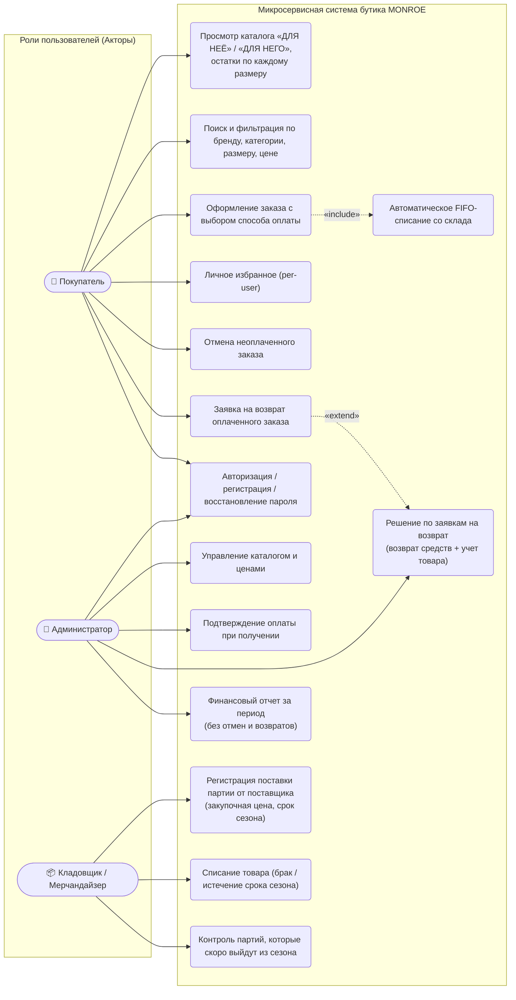
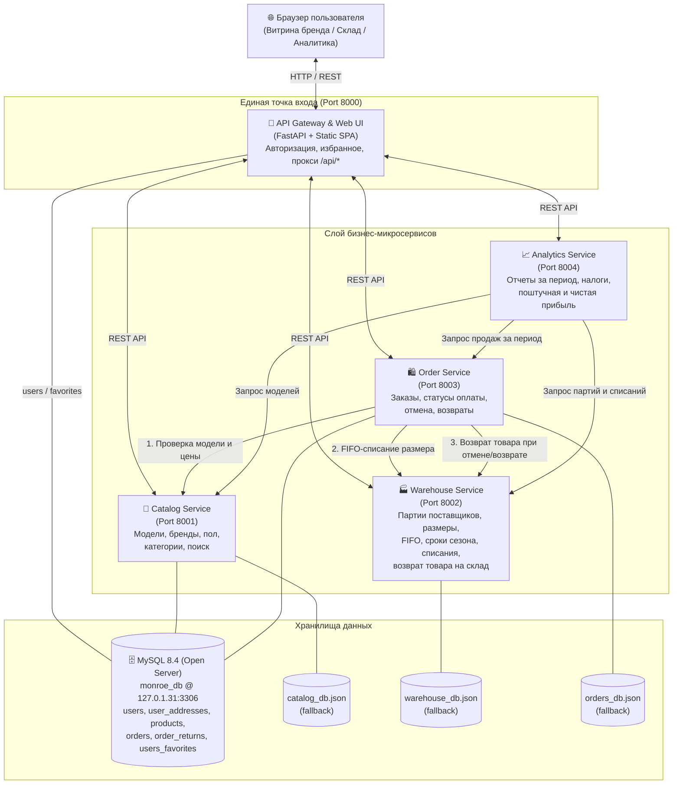
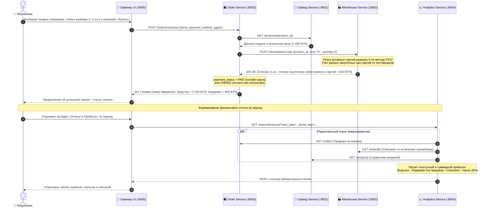
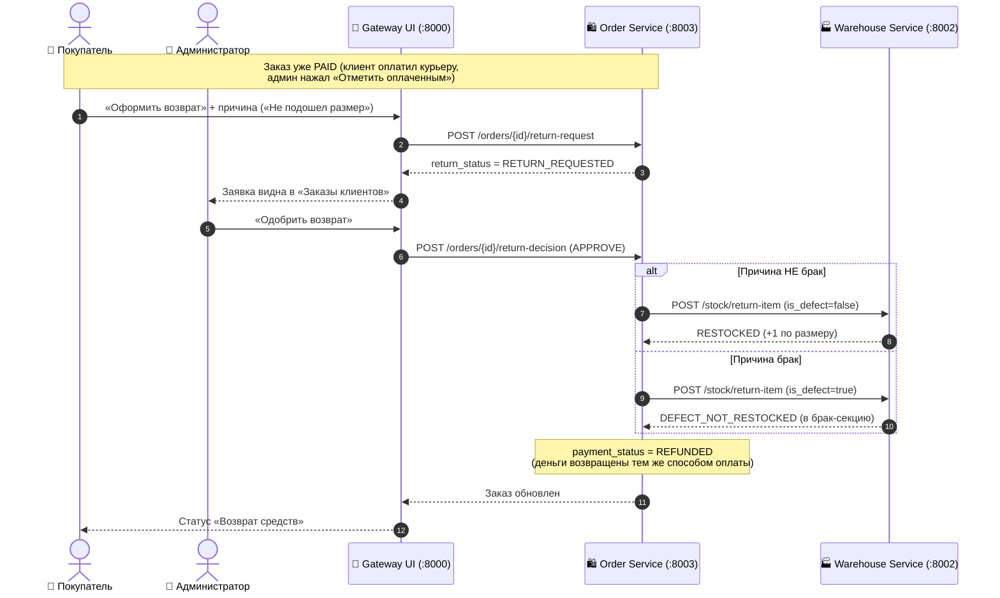
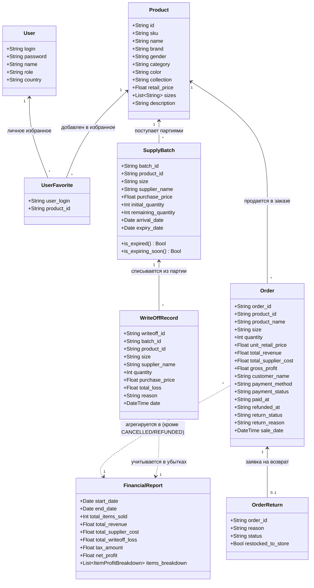

# 🧥 MONROE — Микросервисная система управления брендом одежды и интернет-магазином

Веб-приложение на базе **микросервисной архитектуры** для автоматизации работы мультибрендового бутика одежды **MONROE** (Беларусь, цены в **BYN**): витрина с женским и мужским разделами, управление каталогом и ценами, партионный складской учет партий от разных поставщиков по различным закупочным ценам (FIFO), контроль сроков сезонной реализации и списаний (брак / истечение сезона), оформление заказов с разделением статусов оплаты («Оплачен» / «Ожидает оплаты»), отмена неоплаченных заказов, возвраты с возвратом средств, личное избранное покупателей и расчет чистой прибыли с учетом себестоимости партий и налогов.

---

## 📋 Содержание
1. [Бизнес-требования и описание предметной области](#-1-бизнес-требования-и-описание-предметной-области)
2. [Функциональные и нефункциональные требования](#-2-функциональные-и-нефункциональные-требования)
3. [Анализ рисков и матрица рисков](#-3-анализ-рисков-и-матрица-рисков)
4. [UML-диаграммы (Use Case, Архитектура, Sequence, Class)](#-4-uml-диаграммы)
5. [Описание микросервисов](#-5-описание-микросервисов)
6. [Быстрый запуск проекта](#-6-быстрый-запуск-проекта)

*(Полная версия спецификации также продублирована в файле [`docs/BUSINESS_REQUIREMENTS.md`](docs/BUSINESS_REQUIREMENTS.md)).*

---

## 🎯 1. Бизнес-требования и описание предметной области

### 1.1. Проблематика
Мультибрендовый бутик (**MONROE**, Беларусь, цены в BYN) работает с несколькими поставщиками и дистрибьюторами дизайнерской одежды (PATRIZIA PEPE, GIUSEPPE DI MORABITO и др.). Одна и та же модель (например, *мини-платье PATRIZIA PEPE* размера `S`) в разных партиях поставки имеет **разную закупочную цену (себестоимость)** из-за колебаний цен, курса валют и условий поставки.  
Кроме того, одежда в fashion-индустрии имеет **срок сезонной реализации (срок годности коллекции / дропа)**: по окончании сезона нераспроданные остатки теряют актуальность, требуют уценки или списываются (как неликвид или производственный брак при инвентаризации).  
Отдельная проблема — **оплата и возвраты**: оплата «при получении» не означает, что деньги уже у магазина, а возврат оплаченного товара требует и возврата средств, и корректного учета товара на складе.

### 1.2. Цель проекта
Создать автоматизированную микросервисную систему, которая объединяет витрину интернет-магазина (женский/мужской разделы, личное избранное, статусы оплаты и возвраты), партионный складской учет (приход и списание по методу FIFO) и финансовую аналитику для точного расчета поштучной и суммарной прибыли с учетом закупочных издержек и налогов.

### 1.3. Роли пользователей (Акторы)
* **Покупатель (Клиент):** просматривает каталог («ДЛЯ НЕЁ» / «ДЛЯ НЕГО»), ищет вещи по названию, бренду, категории, размеру и цене, видит точные остатки по размерам, ведет личное избранное, оформляет заказы, отменяет неоплаченные заказы и подает заявки на возврат.
* **Администратор:** управляет каталогом и ценами, видит реестр заказов клиентов, подтверждает оплату при получении («Отметить оплаченным»), одобряет/отклоняет заявки на возврат (с возвратом средств и учетом товара на складе).
* **Кладовщик / Мерчандайзер (доменная роль склада):** регистрирует поступление новых партий одежды от поставщиков (с указанием размера, закупочной цены и даты окончания сезона), отслеживает вещи, у которых скоро истекает срок сезонной реализации, выполняет списание брака и просроченных сезонных остатков.

---

## ⚙️ 2. Функциональные и нефункциональные требования

### 2.1. Функциональные требования (FR)
* **FR-1. Управление каталогом и поиск:**
  * Хранение карточек моделей одежды с разделением по категориям (*Худи и свитшоты*, *Футболки*, *Брюки и деним*, *Верхняя одежда*, *Аксессуары*), коллекциям (*SS26 Street*, *Basic Capsule*, *Limited Drop*) и размерной сетке (`XS`, `S`, `M`, `L`, `XL`).
  * Поиск и фильтрация по названию модели, коллекции, категории, размеру и цене.
* **FR-2. Партионный складской учет (Поступление):**
  * Приемка товара партиями от различных швейных фабрик/поставщиков.
  * Каждая партия фиксирует: модель, размер, поставщика, количество штук, **закупочную цену за единицу**, дату поступления и **срок окончания сезонной годности/реализации**.
* **FR-3. Продажа и списание товара:**
  * При продаже единицы одежды нужного размера система автоматически списывает ее из самой ранней доступной партии (**метод FIFO**) и фиксирует реальную закупочную цену именно этой партии для точного расчета прибыли.
  * Ручное и автоматическое списание единиц товара по причинам: **истечение срока сезонной реализации (просрочка коллекции)** или **производственный брак / порча**.
* **FR-4. Контроль истекающих сроков (Уведомления о рисках неликвида):**
  * Вывод отдельного списка партий товаров с уже истекшим сроком реализации и списка товаров, которые **скоро выйдут из сезона (осталось ≤ 14 дней)**, для своевременного проведения распродажи.
* **FR-5. Финансовая отчетность и аналитика за период:**
  * Подсчет общего количества проданных товаров за выбранный период (суммарно и поштучно в разрезе каждой модели).
  * Расчет выручки, себестоимости проданных партий (издержек на закупку у поставщиков), потерь от списаний, суммы налога (УСН) и итоговой чистой прибыли.
  * Вывод детального реестра списанных товаров по причине истечения срока годности/сезона и брака.
* **FR-6. Статусы оплаты заказа:**
  * Способ оплаты «Онлайн картой на сайте», E-POS, ЕРИП → заказ сразу получает статус **`PAID` (Оплачен)**.
  * Способ «Картой / наличными при получении» → статус **`UNPAID` (Ожидает оплаты)**; администратор подтверждает получение денег кнопкой «Отметить оплаченным» (`POST /orders/{id}/mark-paid`).
  * Отмена неоплаченного заказа (`POST /orders/{id}/cancel`) → `CANCELLED`, товар возвращается на склад.
* **FR-7. Возвраты и возврат средств:**
  * Возврат оформляется только по оплаченному (`PAID`) заказу: покупатель выбирает причину и отправляет заявку (`RETURN_REQUESTED`).
  * Администратор одобряет/отклоняет заявку (`POST /orders/{id}/return-decision`). При одобрении деньги возвращаются тем же способом (`REFUNDED`), товар возвращается в продажу (+1 по размеру), кроме случая брака.
* **FR-8. Аккаунты и личное избранное:**
  * Авторизация/регистрация по номеру телефона, восстановление пароля по SMS-коду.
  * Избранное хранится **персонально для каждого пользователя** в MySQL (`users_favorites`); роли покупатель/администратор строго разделены.
* **FR-9. Панель администратора:**
  * Две рабочие вкладки: «Управление каталогом» (добавление моделей, изменение цены, удаление) и «Заказы клиентов» (статусы оплаты, подтверждение оплаты, решения по возвратам).

### 2.2. Нефункциональные требования (NFR)
* **NFR-1. Микросервисная архитектура:** система должна быть разделена на независимые сервисы (`Catalog`, `Warehouse`, `Order`, `Analytics`, `Gateway`), общающиеся по протоколу HTTP/REST (JSON).
* **NFR-2. Хранение данных:** общая база MySQL `monroe_db` (Open Server, MySQL 8.4) как основное хранилище; JSON-файлы сервисов (`catalog_db.json`, `warehouse_db.json`, `orders_db.json`) используются как fallback и синхронизируются с MySQL.
* **NFR-3. Отказоустойчивость и наблюдаемость:** наличие эндпоинтов `/health` у каждого сервиса и визуального монитора состояния микросервисов в веб-интерфейсе.
* **NFR-4. Кроссплатформенность и простота развертывания:** поддержка запуска как через `Docker Compose`, так и единым Python-оркестратором на Windows/Linux/macOS.

---

## ⚠️ 3. Анализ рисков и матрица рисков

### 3.1. Бизнес-риски и технические риски

| ID | Категория | Описание риска | Вероятность | Влияние | Меры минимизации (Mitigation) в системе |
|:---|:---|:---|:---:|:---:|:---|
| **R-1** | Бизнес | **Затоваривание и истечение срока сезона коллекции:** вещи остаются на складе после окончания сезона и превращаются в неликвид. | Высокая | Высокое | Автоматический мониторинг партий со сроком $\le 14$ дней в `warehouse-service` (блок «Скоро конец сезона») для запуска скидок. |
| **R-2** | Бизнес | **Искажение прибыли из-за разных цен поставщиков:** новые партии от фабрик дороже старых; усреднение цены дает неверный финансовый отчет. | Высокая | Высокое | Партионный учет **FIFO**: при каждом заказе фиксируется точная закупочная цена конкретной списанной партии. |
| **R-3** | Бизнес | **Продажа отсутствующего размера (Overselling):** клиент оформляет заказ на размер `M`, который уже закончился или оказался бракованным. | Средняя | Высокое | Синхронная проверка и атомарное резервирование/списание остатка конкретного размера через `warehouse-service` перед подтверждением заказа. |
| **R-4** | Технический (Микросервисы) | **Недоступность одного из микросервисов** (например, упал `analytics-service` или `warehouse-service`). | Средняя | Среднее | Изоляция сервисов, таймауты HTTP-запросов, health-check мониторинг на дашборде, корректная обработка ошибок (`HTTP 503`) без падения всей системы. |
| **R-5** | Технический (Данные) | **Рассинхронизация данных между заказами и складом** при сбое сети во время покупки. | Низкая | Высокое | Заказ в `order-service` создается только после успешного ответа `200 OK` с расчетом FIFO-себестоимости от `warehouse-service`; статус оплаты (`payment_status`) хранится в MySQL. |
| **R-6** | Бизнес | **Возврат денег по неоплаченному заказу:** клиент требует возврат, хотя еще не платил. | Средняя | Среднее | Возврат разрешен только для `PAID`; для `UNPAID` предусмотрена отмена (`CANCELLED`) без движения денег. |
| **R-7** | Бизнес | **Искажение выручки отменами и возвратами:** отмененные/возвращенные заказы считаются как продажи. | Средняя | Высокое | `Analytics Service` исключает заказы `CANCELLED` и `REFUNDED` из выручки и прибыли. |
| **R-8** | Бизнес | **Потеря товара при возврате/отмене:** деньги вернули, а остаток на складе не обновился. | Средняя | Высокое | Возврат товара выполняется отдельным запросом `POST /stock/return-item`; брак не возвращается в продажу. |

---

## 📊 4. UML-диаграммы

### 4.1. UML-диаграмма вариантов использования (Use Case Diagram)
Отображает взаимодействие ролей (**Покупатель**, **Администратор**, **Кладовщик**) с функционалом системы:



---

### 4.2. Диаграмма микросервисной архитектуры (Component Diagram)
Показывает разделение системы на 4 бизнес-микросервиса и API Gateway с веб-интерфейсом:



---

### 4.3. UML-диаграмма последовательности (Sequence Diagram): Оформление заказа и расчет прибыли
Демонстрирует межсервисное взаимодействие при покупке вещи и последующем формировании финансового отчета:



---

### 4.4. UML-диаграмма последовательности (Sequence Diagram): Возврат оплаченного заказа и возврат средств
Сценарий: курьер доставил товар, клиент оплатил, через день решил вернуть:



---

### 4.5. UML-диаграмма классов предметной области (Class Diagram)



---

## 🧩 5. Описание микросервисов

| Сервис | Порт | Папка | Назначение и ключевые эндпоинты |
|:---|:---:|:---|:---|
| **Gateway & Frontend** | `8000` | `gateway_frontend/` | Веб-интерфейс магазина и админ-панели + проксирование запросов (`/api/*`), авторизация/регистрация/восстановление пароля, личное избранное (`/api/user/{login}/favorites*`) и проверка здоровья всех сервисов (`/api/system-status`). |
| **Catalog Service** | `8001` | `services/catalog_service/` | Управление моделями одежды, брендами, полом («ДЛЯ НЕЁ»/«ДЛЯ НЕГО»), категориями и поиск (`GET /products`, `POST /products`, `PATCH`/`DELETE` цены и позиций). |
| **Warehouse Service** | `8002` | `services/warehouse_service/` | Приход партий от разных поставщиков (`POST /batches`), FIFO-списание при продаже (`POST /stock/deduct-sale`), возврат товара на склад при отмене/возврате (`POST /stock/return-item`, брак не возвращается в продажу), списание просрочки/брака (`POST /writeoffs`), список истекающих партий (`GET /alerts/expiring`), остатки по размерам (`GET /stock/summary`). |
| **Order Service** | `8003` | `services/order_service/` | Оформление корзины (`POST /orders/checkout`) и заказов (`POST /orders`) со статусами оплаты (`UNPAID`/`PAID`/`REFUNDED`/`CANCELLED`), подтверждение оплаты при получении (`POST /orders/{id}/mark-paid`), отмена неоплаченного (`POST /orders/{id}/cancel`), заявки и решения по возврату (`POST /orders/{id}/return-request`, `POST /orders/{id}/return-decision`), история продаж (`GET /orders`). |
| **Analytics Service** | `8004` | `services/analytics_service/` | Сводный финансовый отчет за период (`GET /reports/financial`): поштучная и суммарная прибыль, издержки на поставщиков, налоги (УСН) и потери на списаниях; заказы `CANCELLED` и `REFUNDED` исключаются из выручки. |

---

## 🚀 6. Быстрый запуск проекта

### Вариант 1. Запуск одной командой на Windows / macOS / Linux (Рекомендуется)
1. Установите зависимости:
   ```bash
   pip install -r requirements.txt
   ```
2. Запустите все 5 микросервисов одним скриптом:
   ```bash
   python run_all.py
   ```
   *(На Windows также можно просто дважды кликнуть по файлу **`start.bat`**).*
3. Откройте в браузере:
   * **Веб-приложение бренда MONROE:** [http://localhost:8000](http://localhost:8000)
   * **Swagger UI (Catalog Service):** [http://localhost:8001/docs](http://localhost:8001/docs)
   * **Swagger UI (Warehouse Service):** [http://localhost:8002/docs](http://localhost:8002/docs)
   * **Swagger UI (Order Service):** [http://localhost:8003/docs](http://localhost:8003/docs)
   * **Swagger UI (Analytics Service):** [http://localhost:8004/docs](http://localhost:8004/docs)

### База данных MySQL (Open Server)
* Основной источник данных — **MySQL 8.4** из Open Server: хост `127.0.1.31`, порт `3306`, пользователь `root`, пароль пустой, база **`monroe_db`**.
* Схема создается автоматически при первом подключении (`database/mysql_client.py`); SQL-дамп для просмотра в **DBeaver** лежит в [`database/monroe_mysql.sql`](database/monroe_mysql.sql).
* Таблицы: `users`, `user_addresses`, `products`, `orders` (включая `payment_status`, `paid_at`, `refunded_at`, `return_status`), `order_returns`, `users_favorites`.
* Если MySQL недоступен, сервисы работают на JSON-файлах (fallback), а индикатор в шапке сайта показывает статус подключения.

### Тестовые аккаунты
| Роль | Логин (телефон) | Пароль |
|:---|:---|:---|
| Покупатель | `375445658384` | `123` |
| Администратор | `375291111111` (или `admin`) | `admin123` |

Администратор видит только вкладки «Управление каталогом» и «Заказы клиентов»; покупатель — корзину, избранное и личный кабинет.

### Вариант 2. Запуск в контейнерах Docker Compose
```bash
docker-compose up --build
```
После сборки контейнеров интерфейс также будет доступен по адресу [http://localhost:8000](http://localhost:8000).
