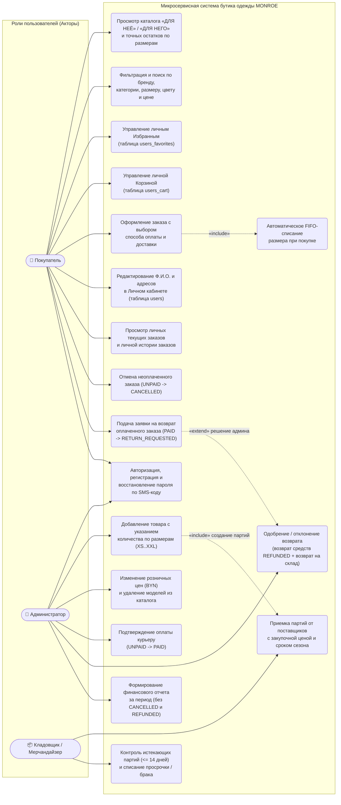
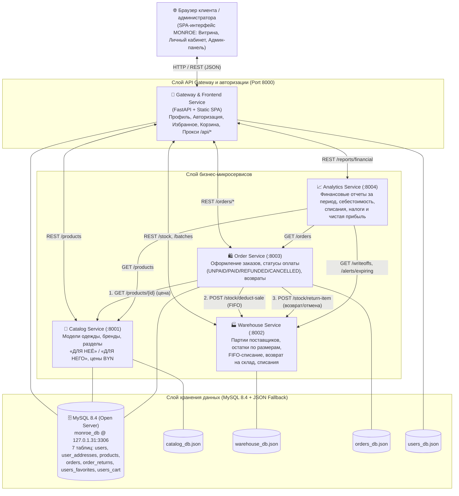
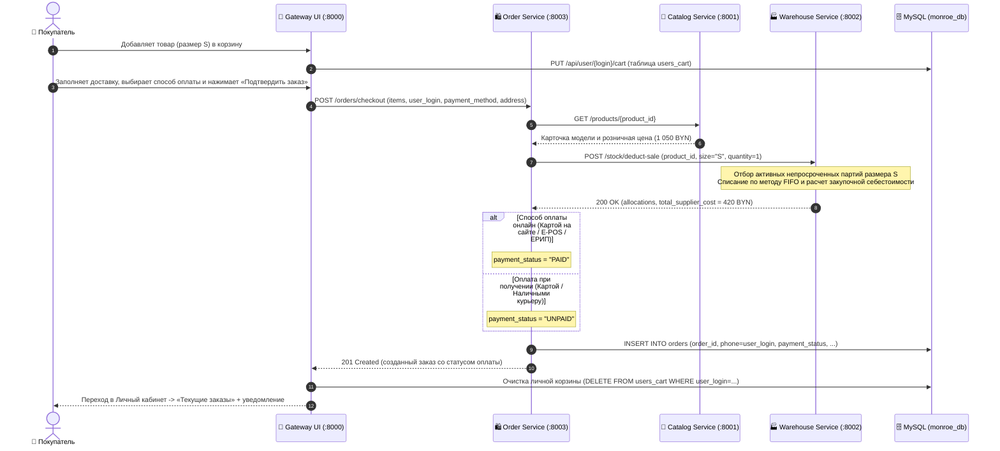
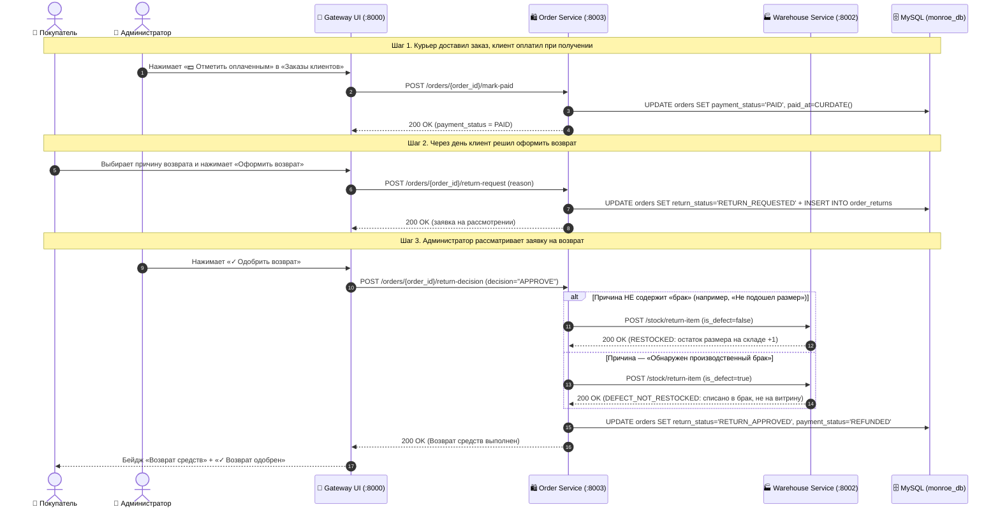
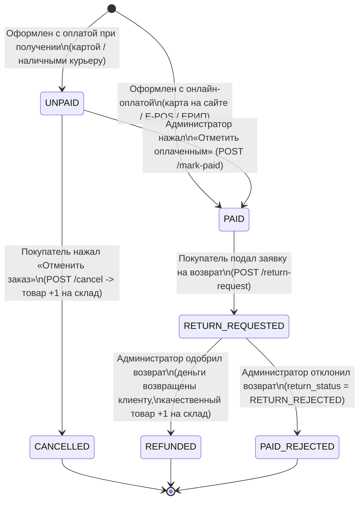
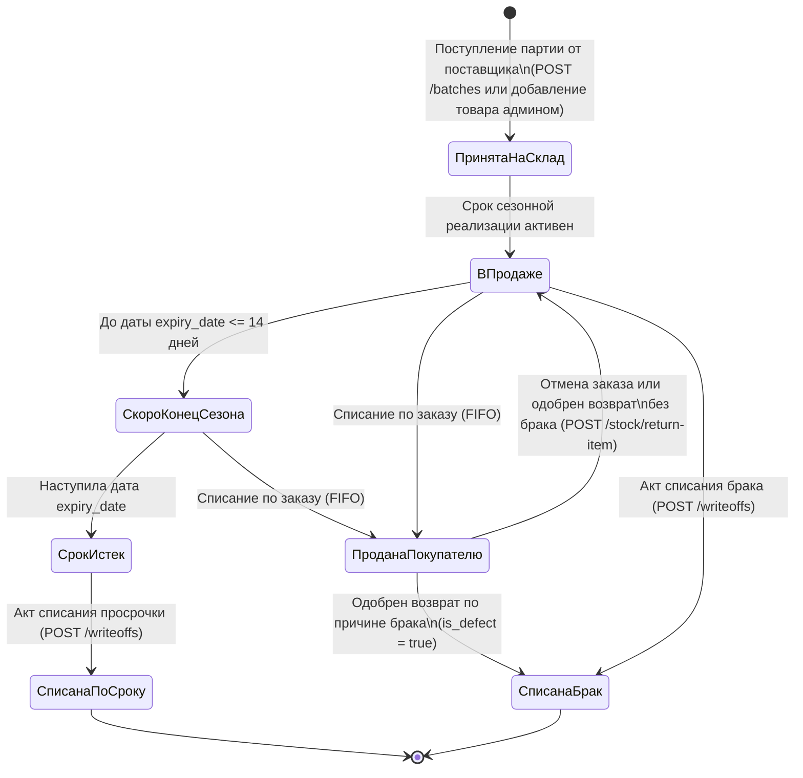
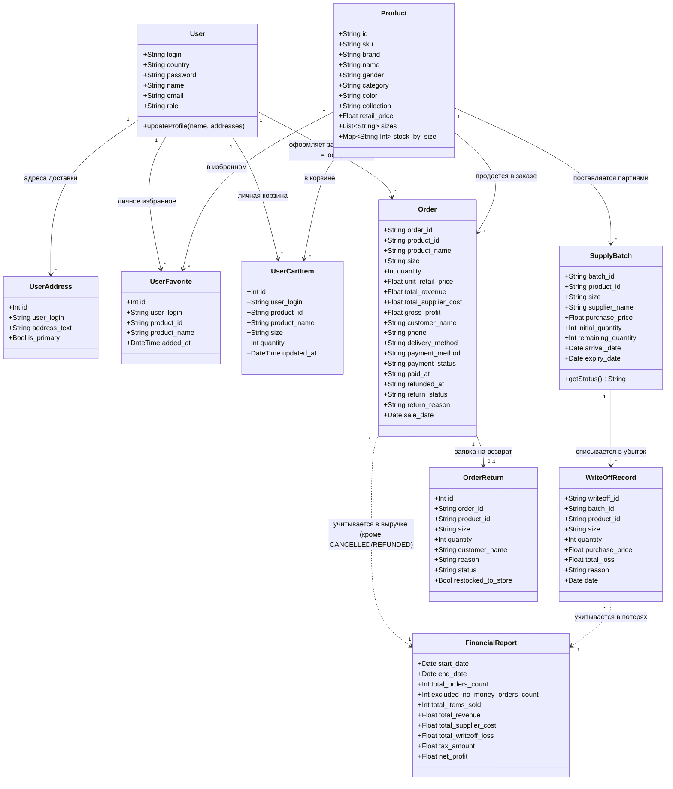

# Спецификация бизнес-требований, анализ рисков и UML-моделирование
## Проект: Автоматизированная микросервисная система бутика брендовой одежды «MONROE»

---

## Содержание
1. [Бизнес-контекст, предметная область и цели проекта](#1-бизнес-контекст-предметная-область-и-цели-проекта)
2. [Функциональные и нефункциональные требования](#2-функциональные-и-нефункциональные-требования)
3. [Детальные сценарии использования (Use Cases)](#3-детальные-сценарии-использования-use-cases)
4. [Модель жизненного цикла заказа, оплаты и возвратов](#4-модель-жизненного-цикла-заказа-оплаты-и-возвратов)
5. [Анализ рисков и матрица управления рисками](#5-анализ-рисков-и-матрица-управления-рисками)
6. [UML-моделирование системы (7 диаграмм)](#6-uml-моделирование-системы-7-диаграмм)
   - [6.1. Диаграмма вариантов использования (UML Use Case Diagram)](#61-диаграмма-вариантов-использования-uml-use-case-diagram)
   - [6.2. Диаграмма компонентов и микросервисной архитектуры (UML Component Diagram)](#62-диаграмма-компонентов-и-микросервисной-архитектуры-uml-component-diagram)
   - [6.3. Диаграмма последовательности: оформление заказа и FIFO-списание (UML Sequence Diagram)](#63-диаграмма-последовательности-оформление-заказа-и-fifo-списание-uml-sequence-diagram)
   - [6.4. Диаграмма последовательности: оплата курьеру, возврат товара и возврат средств (UML Sequence Diagram)](#64-диаграмма-последовательности-оплата-курьеру-возврат-товара-и-возврат-средств-uml-sequence-diagram)
   - [6.5. Диаграмма состояний заказа (UML Statechart Diagram — Order Lifecycle)](#65-диаграмма-состояний-заказа-uml-statechart-diagram--order-lifecycle)
   - [6.6. Диаграмма состояний единицы товара в партии (UML Statechart Diagram — Stock Item)](#66-диаграмма-состояний-единицы-товара-в-партии-uml-statechart-diagram--stock-item)
   - [6.7. Диаграмма классов предметной области и сущностей БД (UML Class Diagram)](#67-диаграмма-классов-предметной-области-и-сущностей-бд-uml-class-diagram)
7. [Архитектура базы данных MySQL (`monroe_db`) и спецификация REST API](#7-архитектура-базы-данных-mysql-monroe_db-и-спецификация-rest-api)

---

## 1. Бизнес-контекст, предметная область и цели проекта

### 1.1. Описание бизнеса
**«MONROE»** — мультибрендовый бутик дизайнерской одежды, обуви и аксессуаров (*PATRIZIA PEPE*, *GIUSEPPE DI MORABITO* и др.), работающий на рынке Республики Беларусь. Все расчеты и цены в каталоге ведутся в белорусских рублях (**BYN**).

Витрина интернет-магазина разделена на два ключевых направления:
* **«ДЛЯ НЕЁ»** (женская коллекция: платья, верхняя одежда, джемперы, пиджаки, брюки, рубашки, джинсы, аксессуары; размерная сетка `XS`, `S`, `M`, `L`, `ONE SIZE`);
* **«ДЛЯ НЕГО»** (мужская коллекция: верхняя одежда, брюки, джемперы, рубашки, футболки, джинсы, шорты, белье, аксессуары; размерная сетка `XXS`, `XS`, `S`, `M`, `L`, `XL`, `XXL`, `XXXL`, `3XL`, `ONE SIZE`).

Поставки продукции осуществляются партиями от нескольких европейских фабрик и дистрибьюторов (*Tessilform S.p.A. (Флоренция, Италия)*, *Morabito Atelier Milano*, *EuroFashion Distribution (Милан)*). Каждая партия имеет собственную закупочную цену, размер, количество единиц и срок сезонной реализации.

### 1.2. Ключевые бизнес-проблемы, которые решает система
1. **Разная закупочная себестоимость партий одного товара:** одна и та же модель одного размера в разных поставках имеет разную закупочную цену из-за колебаний курса валют и условий отгрузки. Без партионного учета по методу **FIFO (First-In, First-Out)** невозможно точно рассчитать себестоимость проданной вещи и реальную валовую прибыль по каждому заказу.
2. **Сезонное устаревание коллекций и контроль списаний:** fashion-коллекции имеют ограниченный срок сезонной актуальности (`expiry_date`). Бутику необходим автоматический мониторинг партий, у которых скоро истекает срок сезона (осталось $\le 14$ дней), для запуска промо-акций, а также строгий учет убытков от списания просроченных остатков и производственного брака.
3. **Прозрачный учет остатков по каждому размеру:** покупатель в каталоге и карточке товара, а также администратор в панели управления должны в реальном времени видеть точное количество доступных единиц каждого размера (`XS: 3 шт.`, `S: 5 шт.`, `M: 4 шт.` и т.д.).
4. **Разделение способа оплаты и фактического статуса оплаты:** выбор способа оплаты при оформлении заказа не всегда означает мгновенное получение денег магазином:
   * при оплате **«Онлайн картой на сайте»**, **«Экспресс Платежи — E-POS»** или **«Экспресс Платежи — ЕРИП»** транзакция проходит сразу — заказ получает статус **`PAID` (Оплачен)**;
   * при оплате **«Картой при получении»** или **«Наличными при получении»** деньги поступают только после доставки курьером — заказ создается в статусе **`UNPAID` (Ожидает оплаты)** и переводится в `PAID` администратором после фактического получения оплаты.
5. **Корректная обработка отмен и возвратов товара:**
   * если заказ еще не оплачен (`UNPAID`), клиент может его **отменить** (`CANCELLED`) — деньги не возвращаются (так как не списывались), а зарезервированный размер возвращается на склад;
   * если заказ уже оплачен (`PAID`), клиент может подать **заявку на возврат** с указанием причины (`RETURN_REQUESTED`). При одобрении администратором клиенту возвращаются средства (`REFUNDED`), а товар возвращается в доступный остаток на склад (`+1` к размеру) только в том случае, если причина возврата — **не производственный брак**.
6. **Персонализация и изоляция данных клиентов:** каждый авторизованный покупатель должен иметь собственное Ф.И.О. (сохраняемое в БД и отображаемое в приветствии Личного кабинета), индивидуальную корзину (`users_cart`), индивидуальный список избранного (`users_favorites`), собственные адреса доставки и видеть в истории только свои заказы.

### 1.3. Бизнес-цели и критерии успеха проекта (KPI)
* **Точность финансового учета 100%:** каждый заказ фиксирует реальную закупочную стоимость списанных по FIFO партий, а заказы в статусах `CANCELLED` и `REFUNDED` автоматически исключаются из выручки.
* **Предотвращение продаж отсутствующих размеров (Overselling = 0):** синхронная проверка и списание остатков конкретного размера в `Warehouse Service` при оформлении заказа.
* **Полная изоляция ролей и персональных данных:** строгое разделение интерфейса Покупателя и Администратора, хранение корзины, избранного, профиля и заказов в привязке к логину пользователя в СУБД MySQL 8.4.

### 1.4. Роли пользователей (Акторы) и разграничение прав

| Актор (Роль) | Учетные данные (демо) | Доступный функционал в системе | Ограничения роли |
|:---|:---|:---|:---|
| **Покупатель (Клиент)** | `375445658384` / `123` `375447573540` (`Олег`) / `123` *(или регистрация нового)* | Просмотр витрины «ДЛЯ НЕЁ» / «ДЛЯ НЕГО», фильтрация и поиск, просмотр остатков по размерам, личное Избранное, личная Корзина, оформление заказа, редактирование Ф.И.О. и адресов, просмотр личных текущих заказов и истории, отмена неоплаченного заказа, подача заявки на возврат оплаченного заказа. | Не видит панель управления каталогом и чужие заказы других покупателей. |
| **Администратор бутика** | `375291111111` / `admin123` `admin` / `admin123` | Вкладка **«Управление каталогом и ценами»**: добавление новых товаров с указанием точного количества единиц по каждому размеру (`XS`–`XXL`), изменение розничных цен, удаление моделей. Вкладка **«Заказы клиентов»**: просмотр всех заказов бутика, отметка оплаты курьеру («Отметить оплаченным»), одобрение и отклонение заявок на возврат. | В шапке скрыты клиентские иконки Корзины и Избранного; скрыты клиентские вкладки личных данных и адресов. |
| **Кладовщик / Мерчандайзер** | *Доменная роль API склада (`:8002`)* | Приемка новых партий от поставщиков (`POST /batches`), мониторинг сроков окончания сезона (`GET /alerts/expiring`), списание просрочки и брака (`POST /writeoffs`). | Работает со складским микросервисом и партионным учетом. |

---

## 2. Функциональные и нефункциональные требования

### 2.1. Функциональные требования (FR)

| Код | Модуль / Сервис | Описание функционального требования |
|:---:|:---|:---|
| **FR-01** | `Catalog Service` | Хранение и выдача каталога моделей одежды с разделением по полу («ДЛЯ НЕЁ» / «ДЛЯ НЕГО»), категории, бренду, цвету, размерной сетке и цене в BYN. Поддержка фильтрации, сортировки и полнотекстового поиска. |
| **FR-02** | `Warehouse Service` | Партионный учет поставок: хранение партий с привязкой к модели, размеру, поставщику, закупочной цене, начальному/текущему остатку и дате истечения сезонной реализации (`expiry_date`). |
| **FR-03** | `Warehouse Service` | Автоматическое списание единиц нужного размера при продаже по методу **FIFO** (из самых ранних непросроченных партий) с расчетом точной закупочной себестоимости списанных единиц. |
| **FR-04** | `Warehouse Service` | Возврат товара на склад (`POST /stock/return-item`) при отмене заказа или одобрении возврата администратором. Если причина возврата содержит признак брака (`is_defect = true`), товар не возвращается в доступный остаток витрины. |
| **FR-05** | `Gateway & Auth` | Регистрация, авторизация по номеру телефона и паролю, восстановление пароля через SMS-код, редактирование и сохранение Ф.И.О. пользователя в БД (`POST /api/auth/update-profile`) с отображением Ф.И.О. в приветствии Личного кабинета. |
| **FR-06** | `Gateway & MySQL` | Персональное Избранное (`users_favorites`) и персональная Корзина (`users_cart`) в MySQL: у каждого аккаунта свой изолированный список избранных моделей и товаров в корзине. |
| **FR-07** | `Order Service` | Оформление заказа из корзины (`POST /orders/checkout`) с привязкой к логину покупателя (`user_login` / `phone`), автоматическим определением начального статуса оплаты (`PAID` для онлайн-оплаты, `UNPAID` для оплаты при получении) и применением купонов скидки (`MAD10`, `SALE10`, `VIP10`). |
| **FR-08** | `Order Service` | Управление жизненным циклом оплаты и возвратов: подтверждение оплаты при получении администратором (`POST /orders/{id}/mark-paid`), отмена неоплаченного заказа покупателем (`POST /orders/{id}/cancel`), подача заявки на возврат оплаченного заказа (`POST /orders/{id}/return-request`) и решение администратора (`POST /orders/{id}/return-decision`). |
| **FR-09** | `Gateway UI (Admin)` | Панель администратора: добавление нового товара с вводом количества штук по каждому размеру (`XS`, `S`, `M`, `L`, `XL`, `XXL`) и автоматическим созданием складских партий, оперативное изменение розничной цены (`PATCH`) и удаление товара (`DELETE`). |
| **FR-10** | `Analytics Service` | Расчет финансового отчета за период (`GET /reports/financial`): поштучная и сводная выручка, себестоимость партий поставщиков, валовая прибыль, потери от списаний (просрочка и брак), налог и чистая прибыль. Заказы `CANCELLED` и `REFUNDED` исключаются из выручки. |

### 2.2. Нефункциональные требования (NFR)
* **NFR-01. Микросервисная архитектура:** система разделена на 5 независимых процессов (`Gateway :8000`, `Catalog :8001`, `Warehouse :8002`, `Order :8003`, `Analytics :8004`), взаимодействующих по HTTP/REST (JSON).
* **NFR-02. Гибридная персистентность (MySQL 8.4 + JSON Fallback):** основное хранилище — реляционная СУБД **MySQL 8.4** (Open Server, база `monroe_db` на `127.0.1.31:3306`); при временной недоступности СУБД сервисы продолжают работу на локальных JSON-файлах без падения приложения.
* **NFR-03. Наблюдаемость и мониторинг здоровья (Observability):** каждый микросервис предоставляет эндпоинт `GET /health`, а шлюз агрегирует статусы всех сервисов и подключения к MySQL через `GET /api/system-status` и отображает их индикаторами в верхней панели сайта.
* **NFR-04. Изоляция пользовательских сессий:** данные корзины, избранного, адресов и истории заказов изолированы по идентификатору пользователя как на уровне таблиц MySQL, так и на уровне ключей `localStorage`.
* **NFR-05. Автоматизация развертывания:** запуск всех 5 микросервисов с автоматическим освобождением занятых портов одной командой (`python run_all.py` или `start.bat`), а также поддержка контейнеризации (`Dockerfile`, `docker-compose.yml`).

---

## 3. Детальные сценарии использования (Use Cases)

### UC-01: Просмотр каталога, фильтрация и проверка остатков по размерам
* **Актор:** Покупатель.
* **Предусловие:** `Catalog Service` и `Warehouse Service` активны.
* **Основной поток:**
  1. Покупатель выбирает раздел «ДЛЯ НЕЁ» или «ДЛЯ НЕГО» либо вводит запрос в строку поиска.
  2. Отмечает фильтры в боковой панели (категории одежды/аксессуаров, размер, бренд, цвет, диапазон цены).
  3. Интерфейс запрашивает модели (`GET /api/catalog/products`) и актуальные складские остатки (`GET /api/warehouse/stock-summary`).
  4. На каждой карточке товара и на детальной странице отображаются бейджи размеров с точным количеством штук в наличии (`XS: 3 шт.`, `S: 5 шт.` и т.д.).

### UC-02: Работа с персональным Избранным и персональной Корзиной
* **Актор:** Авторизованный покупатель.
* **Предусловие:** Покупатель вошел в аккаунт.
* **Основной поток:**
  1. Покупатель нажимает на иконку сердечка на карточке или странице товара — отправляется `POST /api/user/{login}/favorites/add`, запись сохраняется в таблицу `users_favorites` MySQL.
  2. Покупатель выбирает размер и нажимает «ДОБАВИТЬ В КОРЗИНУ» — позиция добавляется в личную корзину и синхронизируется с таблицей `users_cart` MySQL (`PUT /api/user/{login}/cart`).
  3. При выходе из аккаунта и входе под другим пользователем загружаются собственные `users_favorites` и `users_cart` нового пользователя.

### UC-03: Оформление заказа (Checkout) с онлайн-оплатой или оплатой при получении
* **Актор:** Покупатель.
* **Предусловие:** В личной корзине покупателя есть хотя бы один товар доступного размера.
* **Основной поток:**
  1. Покупатель переходит к оформлению заказа; поля Ф.И.О., телефона и e-mail автоматически предзаполняются из профиля пользователя.
  2. Выбирает способ доставки и способ оплаты, при наличии вводит купон (`MAD10` / `SALE10` / `VIP10`) и подтверждает заказ (`POST /api/orders/checkout`).
  3. `Order Service` проверяет цену модели в `Catalog Service` и списывает нужный размер в `Warehouse Service` по методу FIFO (`POST /stock/deduct-sale`).
  4. `Order Service` присваивает заказу начальный статус оплаты:
     * **`PAID`** — если выбран онлайн-способ («Онлайн картой на сайте», «Экспресс Платежи — E-POS», «Экспресс Платежи — ЕРИП»);
     * **`UNPAID`** — если выбрана оплата курьеру («Картой при получении», «Наличными при получении»).
  5. Заказ сохраняется в таблицу `orders` MySQL с привязкой к логину покупателя, корзина очищается, покупатель перенаправляется в Личный кабинет → «Ваши заказы» → «Текущие заказы».

### UC-04: Редактирование Ф.И.О. и контактных данных в Личном кабинете
* **Актор:** Покупатель.
* **Основной поток:**
  1. Покупатель открывает Личный кабинет → вкладка «Ваши данные».
  2. Изменяет поле «Ф.И.О.» (например, с номера телефона `375447573540` на `Олег`) и нажимает «Сохранить».
  3. Шлюз вызывает `POST /api/auth/update-profile`, обновляет поле `name` в таблице `users` MySQL и `users_db.json`.
  4. Приветствие в шапке Личного кабинета и при последующих входах сразу отображает: **«Здравствуйте, Олег»**.

### UC-05: Отмена неоплаченного заказа покупателем
* **Актор:** Покупатель.
* **Предусловие:** Заказ находится в статусе `payment_status = UNPAID`.
* **Основной поток:**
  1. В разделе «Ваши заказы» у неоплаченного заказа отображается бейдж «Ожидает оплаты» и кнопка «Отменить заказ».
  2. Покупатель нажимает «Отменить заказ» (`POST /api/orders/{id}/cancel`).
  3. `Order Service` возвращает списанный размер обратно на склад (`POST /stock/return-item`, `is_defect = false`) и переводит заказ в статус `CANCELLED`.
  4. Деньги не возвращаются, так как оплата еще не производилась.

### UC-06: Подтверждение оплаты при получении администратором
* **Актор:** Администратор.
* **Предусловие:** Курьер доставил заказ со способом оплаты «при получении» (`payment_status = UNPAID`) и принял оплату от клиента.
* **Основной поток:**
  1. Администратор открывает вкладку «Заказы клиентов» и видит у заказа бейдж «Ожидает оплаты» и кнопку «💵 Отметить оплаченным».
  2. Нажимает кнопку (`POST /api/orders/{id}/mark-paid`).
  3. Статус заказа меняется на `PAID`, фиксируется дата оплаты `paid_at`. Теперь клиенту при необходимости доступен возврат товара.

### UC-07: Заявка на возврат оплаченного заказа, решение администратора и возврат средств
* **Актор:** Покупатель, Администратор.
* **Предусловие:** Заказ оплачен (`payment_status = PAID`), `return_status = NONE`.
* **Основной поток:**
  1. Покупатель в Личном кабинете выбирает причину возврата («Не подошел размер», «Не подошел фасон / цвет», «Обнаружен производственный брак») и нажимает «Оформить возврат» (`POST /api/orders/{id}/return-request`).
  2. Заказ переходит в `return_status = RETURN_REQUESTED`, запись дублируется в таблицу `order_returns` MySQL.
  3. Администратор во вкладке «Заказы клиентов» видит причину возврата и нажимает «✓ Одобрить возврат» либо «✕ Отклонить» (`POST /api/orders/{id}/return-decision`).
  4. **При одобрении (`APPROVE`):**
     * статус возврата становится `RETURN_APPROVED`, а статус оплаты — **`REFUNDED` (Возврат средств)**, фиксируется `refunded_at`;
     * если причина **не брак**, `Order Service` вызывает `POST /stock/return-item` (`is_defect = false`), и размер автоматически возвращается в наличие на склад (`+1 шт.`);
     * если причина — **брак**, вызывается `POST /stock/return-item` (`is_defect = true`), товар списывается в брак и на витрину не возвращается.
  5. **При отклонении (`REJECT`):** `return_status = RETURN_REJECTED`, статус оплаты остается `PAID`.
* **Альтернативный поток:** если покупатель пытается оформить возврат по неоплаченному заказу (`UNPAID`), сервер возвращает `HTTP 400` с подсказкой использовать отмену заказа.

### UC-08: Управление каталогом, ценами и остатками по размерам
* **Актор:** Администратор.
* **Основной поток:**
  1. Администратор открывает вкладку «Управление каталогом и ценами».
  2. Заполняет название модели, розничную цену в BYN, бренд, раздел («ДЛЯ НЕЁ» / «ДЛЯ НЕГО»), категорию, ссылку на фото и указывает **количество единиц по каждому размеру** (`XS`, `S`, `M`, `L`, `XL`, `XXL`).
  3. При нажатии «Добавить» (`POST /api/catalog/products`) модель создается в `Catalog Service`, а в `Warehouse Service` автоматически создаются партии для каждого размера с указанным количеством штук.
  4. В списке товаров администратор может изменить цену любой модели (`PATCH /api/catalog/products/{id}`) или удалить модель (`DELETE /api/catalog/products/{id}`).

---

## 4. Модель жизненного цикла заказа, оплаты и возвратов

Каждый заказ в системе описывается парой статусов: **`payment_status`** (состояние оплаты) и **`return_status`** (состояние заявки на возврат).

| `payment_status` | `return_status` | Бейдж в интерфейсе | Бизнес-смысл и доступные действия | Учет в выручке (`Analytics`) |
|:---:|:---:|:---|:---|:---:|
| `UNPAID` | `NONE` | `Ожидает оплаты` | Заказ оформлен с оплатой при получении. Покупателю доступна кнопка **«Отменить заказ»**; администратору — **«💵 Отметить оплаченным»**. Возврат недоступен до оплаты. | Да (активный заказ) |
| `PAID` | `NONE` | `✓ Оплачен` | Деньги получены (онлайн при оформлении либо подтверждены админом после доставки курьером). Покупателю доступна форма **«Оформить возврат»**. | Да |
| `PAID` | `RETURN_REQUESTED` | `✓ Оплачен` + `⏳ Заявка на возврат` | Покупатель отправил заявку на возврат с причиной. Администратору доступны кнопки **«✓ Одобрить возврат»** и **«✕ Отклонить»**. | Да (до решения) |
| `REFUNDED` | `RETURN_APPROVED` | `Возврат средств` + `✓ Возврат одобрен` | Администратор одобрил возврат: деньги возвращены клиенту тем же способом оплаты; качественный товар вернулся на склад (`+1`), брак списан. | **Нет (исключен)** |
| `PAID` | `RETURN_REJECTED` | `✓ Оплачен` + `✕ Возврат отклонён` | Администратор отклонил заявку на возврат. Товар остается у покупателя, деньги у бутика. | Да |
| `CANCELLED` | `NONE` | `✕ Отменён` | Неоплаченный заказ отменен покупателем до оплаты. Товар вернулся на склад (`+1`), движения денег не было. | **Нет (исключен)** |

---

## 5. Анализ рисков и матрица управления рисками

| ID | Категория | Описание риска | Вероятность | Влияние | Меры минимизации (Mitigation) в системе |
|:---:|:---|:---|:---:|:---:|:---|
| **R-01** | Бизнес / Финансы | **Искажение прибыли из-за разных закупочных цен партий:** новые поставки от фабрик дороже предыдущих; усреднение цены дает неверный расчет маржи. | Высокая | Высокое | Партионный учет **FIFO** в `Warehouse Service`: при каждом заказе списываются самые ранние партии и фиксируется их точная закупочная стоимость. |
| **R-02** | Бизнес / Склад | **Затоваривание и сезонное устаревание коллекции:** вещи остаются непроданными к концу сезона и превращаются в неликвид. | Высокая | Высокое | Эндпоинт `GET /alerts/expiring` выделяет партии со сроком до конца сезона $\le 14$ дней и просроченные партии для распродаж и списания. |
| **R-03** | Бизнес / Склад | **Продажа отсутствующего размера (Overselling):** покупатель оформляет размер, который уже закончился на складе. | Средняя | Высокое | Синхронная проверка и атомарное списание остатка конкретного размера через `POST /stock/deduct-sale` перед созданием заказа. |
| **R-04** | Бизнес / Финансы | **Требование возврата денег по неоплаченному заказу:** клиент оформляет заказ с оплатой курьеру и до оплаты подает заявку на возврат средств. | Средняя | Среднее | В `Order Service` (`POST /orders/{id}/return-request`) возврат разрешен строго для `payment_status == PAID`; для `UNPAID` доступна только отмена (`CANCELLED`). |
| **R-05** | Бизнес / Склад | **Потеря товара или возврат брака на витрину при возврате:** после одобрения возврата остаток на складе не обновился либо бракованная вещь снова попала в продажу. | Средняя | Высокое | При `APPROVE` автоматически вызывается `POST /stock/return-item`: качественный товар увеличивает остаток размера (`+1`), а при признаке «брак» (`is_defect = true`) товар на витрину не возвращается. |
| **R-06** | Бизнес / Аналитика | **Завышение выручки за счет отмененных и возвращенных заказов:** заказы, по которым деньги не получены или возвращены, попадают в отчет прибыли. | Средняя | Высокое | `Analytics Service` фильтрует заказы и исключает `CANCELLED` и `REFUNDED` из расчета выручки, валовой и чистой прибыли. |
| **R-07** | Безопасность / Данные | **Смешивание корзин, избранного и истории заказов разных пользователей:** один клиент видит чужую корзину или чужие заказы. | Средняя | Высокое | Хранение корзины в таблице `users_cart`, избранного в `users_favorites`, фильтрация заказов покупателя по его логину/телефону и имени, разделение ключей `localStorage` по логину. |
| **R-08** | Технический | **Временная недоступность СУБД MySQL (Open Server не запущен):** падение всех сервисов при старте без БД. | Средняя | Высокое | Двухуровневый слой хранения в `database/mysql_client.py`: при недоступности MySQL сервисы автоматически переключаются на JSON-файлы, а статус БД виден в шапке сайта. |
| **R-09** | Технический | **Конфликт портов (`8000`–`8004`) при повторном запуске сервисов на Windows.** | Высокая | Среднее | Оркестратор `run_all.py` перед стартом автоматически находит и завершает старые процессы на портах `8000`–`8004`. |

---

## 6. UML-моделирование системы (7 диаграмм)

### 6.1. Диаграмма вариантов использования (UML Use Case Diagram)

---

### 6.2. Диаграмма компонентов и микросервисной архитектуры (UML Component Diagram)

---

### 6.3. Диаграмма последовательности: оформление заказа и FIFO-списание (UML Sequence Diagram)

---

### 6.4. Диаграмма последовательности: оплата курьеру, возврат товара и возврат средств (UML Sequence Diagram)

---

### 6.5. Диаграмма состояний заказа (UML Statechart Diagram — Order Lifecycle)

---

### 6.6. Диаграмма состояний единицы товара в партии (UML Statechart Diagram — Stock Item)

---

### 6.7. Диаграмма классов предметной области и сущностей БД (UML Class Diagram)

---

## 7. Архитектура базы данных MySQL (`monroe_db`) и спецификация REST API

### 7.1. Таблицы базы данных `monroe_db` (MySQL 8.4, Open Server `127.0.1.31:3306`)

SQL-схема для импорта и просмотра в **DBeaver** находится в файле [`database/monroe_mysql.sql`](../database/monroe_mysql.sql), автоматическая инициализация и синхронизация — в [`database/mysql_client.py`](../database/mysql_client.py).

| № | Таблица MySQL | Первичный / уникальный ключ | Назначение и ключевые поля |
|:---:|:---|:---|:---|
| 1 | `users` | `id` (`UNIQUE login`) | Аккаунты покупателей и администраторов (`login`, `country`, `password`, `name` — Ф.И.О., `email`, `role`, `addresses_json`). |
| 2 | `user_addresses` | `id` (`FK user_login`) | Адреса доставки каждого пользователя (`user_login`, `address_text`, `is_primary`). |
| 3 | `products` | `id` | Каталог моделей бутика (`sku`, `brand`, `name`, `gender`, `category`, `retail_price`, `sizes_json`, `stock_by_size_json`). |
| 4 | `orders` | `order_id` | Заказы клиентов (`product_id`, `size`, `quantity`, `total_revenue`, `total_supplier_cost`, `gross_profit`, `customer_name`, `phone`, `payment_method`, `payment_status`, `paid_at`, `refunded_at`, `return_status`, `return_reason`). |
| 5 | `order_returns` | `id` (`UNIQUE order_id`) | Журнал заявок на возврат и решений администратора (`order_id`, `product_id`, `size`, `quantity`, `customer_name`, `reason`, `status`, `restocked_to_store`). |
| 6 | `users_favorites` | `id` (`UNIQUE user_login, product_id`) | Личное избранное каждого пользователя (`user_login`, `product_id`, `product_name`, `added_at`). |
| 7 | `users_cart` | `id` (`UNIQUE user_login, product_id, size`) | Личная корзина каждого покупателя (`user_login`, `product_id`, `product_name`, `size`, `quantity`, `updated_at`). |

### 7.2. Сводная спецификация эндпоинтов микросервисов

| Микросервис | Порт | Метод и путь | Назначение |
|:---|:---:|:---|:---|
| **Gateway & Frontend** | `8000` | `GET /` `GET /api/system-status` `POST /api/auth/login` `POST /api/auth/register` `POST /api/auth/update-profile` `GET /api/user/{login}/profile` `POST /api/auth/request-reset-code` `POST /api/auth/reset-password` `GET /api/user/{login}/favorites` `POST /api/user/{login}/favorites/add` `DELETE /api/user/{login}/favorites/remove` `GET /api/user/{login}/cart` `PUT /api/user/{login}/cart` | Отдача SPA-интерфейса, мониторинг всех микросервисов и MySQL, авторизация, сохранение Ф.И.О. в БД, восстановление пароля по SMS, персональное избранное и персональная корзина, проксирование запросов к бизнес-сервисам. |
| **Catalog Service** | `8001` | `GET /health` `GET /products` `GET /products/{id}` `POST /products` `PATCH /products/{id}` `DELETE /products/{id}` | Каталог моделей одежды, фильтрация по разделу («ДЛЯ НЕЁ» / «ДЛЯ НЕГО»), категории, бренду, размеру и цене, создание моделей, обновление розничной цены и удаление. |
| **Warehouse Service** | `8002` | `GET /health` `GET /batches` `POST /batches` `GET /stock/summary` `POST /stock/deduct-sale` `POST /stock/return-item` `GET /alerts/expiring` `GET /writeoffs` `POST /writeoffs` | Партионный складской учет, точные остатки по размерам, FIFO-списание при продаже, возврат товара на склад при отмене/возврате (с фильтрацией брака), контроль сроков сезона и акты списания. |
| **Order Service** | `8003` | `GET /health` `GET /orders` `POST /orders` `POST /orders/checkout` `POST /orders/{id}/mark-paid` `POST /orders/{id}/cancel` `POST /orders/{id}/return-request` `POST /orders/{id}/return-decision` | Оформление заказов, расчет выручки и FIFO-себестоимости, статусы оплаты (`UNPAID`, `PAID`, `REFUNDED`, `CANCELLED`), подтверждение оплаты курьеру, отмена неоплаченного заказа, заявки и решения по возвратам. |
| **Analytics Service** | `8004` | `GET /health` `GET /reports/financial` | Сводная и поштучная финансовая аналитика за период: выручка (без отмененных и возвращенных заказов), себестоимость партий, списания, налог и чистая прибыль. |
