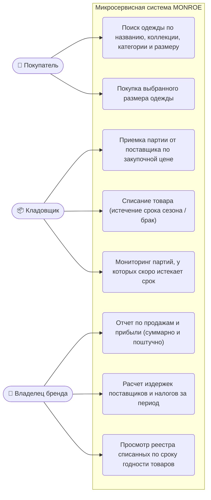
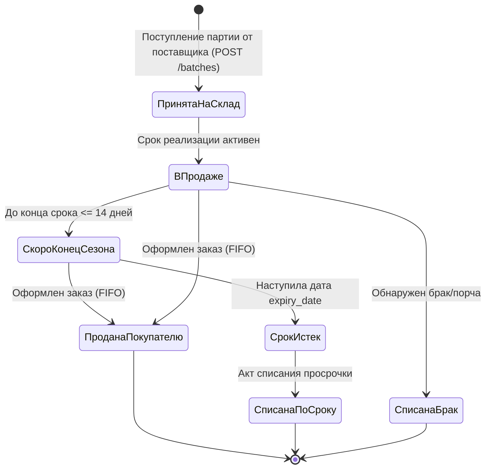

# Спецификация бизнес-требований, анализ рисков и UML-моделирование
## Проект: Автоматизированная микросервисная система бренда одежды «MONROE»

---

## 1. Бизнес-контекст и цели проекта

### 1.1. Описание бизнеса
**«MONROE»** — российский бренд повседневной и уличной одежды (Streetwear & Basic Capsule), выпускающий регулярные сезонные дропы и базовые коллекции.  
Отшив продукции распределен между несколькими швейными производствами и поставщиками (например, *«Фабрика ТекстильПро»*, *«Ателье МодаПлюс»*, *«CottonCraft Иваново»*).

### 1.2. Ключевые бизнес-проблемы, которые решает система
1. **Разная себестоимость партий одного товара:** одна и та же модель (например, *Худи Оверсайз «Eclipse»*) поступает от разных поставщиков и в разное время по разной закупочной цене (например, первая партия по 2 300 ₽/шт., вторая партия по 2 750 ₽/шт.). Без партионного учета невозможно точно посчитать реальную прибыль с каждой проданной вещи.
2. **Сезонное устаревание и списание (срок годности/реализации коллекции):** сезонные коллекции одежды имеют строгий срок актуальности (срок годности на полке до окончания сезона) и подвержены риску брака/порчи при хранении и примерках. Магазину необходимо заранее видеть партии, у которых скоро истекает срок реализации, чтобы вовремя объявить распродажу, а просроченные или бракованные единицы — корректно списывать с учетом убытков.
3. **Размерная сетка и поиск:** покупателям необходим удобный поиск вещей по названию, коллекции, категории и доступному размеру (`XS`, `S`, `M`, `L`, `XL`).
4. **Прозрачная налоговая и управленческая отчетность:** руководству бренда нужен автоматический отчет за любой период: сколько товара продано (поштучно и суммарно), какая получена выручка, сколько потрачено на закупку у поставщиков, сколько потеряно на списаниях, какой налог нужно уплатить и какова чистая прибыль.

---

## 2. Сценарии использования (Use Cases)

### UC-01: Поиск и покупка одежды покупателем
* **Актор:** Покупатель.
* **Предусловие:** В каталоге есть модели одежды, а на складе — активные непросроченные партии нужного размера.
* **Основной поток:**
  1. Покупатель открывает витрину бренда, использует фильтры по категории, коллекции, размеру или поисковой строке.
  2. Выбирает модель одежды, нужный размер (`XS`–`XL`) и количество.
  3. Нажимает «Оформить заказ».
  4. `Order Service` запрашивает розничную цену в `Catalog Service` и отправляет запрос на списание в `Warehouse Service`.
  5. `Warehouse Service` списывает нужное количество единиц из самых старых действующих партий (**метод FIFO**) и возвращает суммарную закупочную стоимость списанных единиц.
  6. Заказ сохраняется, покупатель получает подтверждение.

### UC-02: Приемка новой партии товара от поставщика
* **Актор:** Кладовщик / Мерчандайзер.
* **Основной поток:**
  1. Кладовщик выбирает модель из каталога и размер (`S`, `M`, `L` и т.д.).
  2. Указывает наименование поставщика (швейной фабрики), количество единиц, закупочную цену за 1 шт. и дату окончания срока сезонной реализации (годности).
  3. `Warehouse Service` регистрирует новую партию и обновляет доступные остатки размера.

### UC-03: Контроль сроков и списание товара (просрочка сезона / брак)
* **Актор:** Кладовщик / Мерчандайзер.
* **Основной поток:**
  1. Кладовщик открывает панель контроля сроков реализации.
  2. Система автоматически выделяет две группы риска:
     * **Скоро истекает срок сезона (≤ 14 дней)** — сигнал для запуска акции/распродажи.
     * **Срок реализации истек** — товар подлежит списанию/утилизации/аутлет-списанию.
  3. Кладовщик нажимает «Списать по истечению срока» (или списывает обнаруженный брак), указывая количество и причину.
  4. Система уменьшает остаток партии и фиксирует акт списания с суммой убытка по закупочной цене поставщика.

### UC-04: Формирование финансового отчета за период
* **Актор:** Владелец бренда / Менеджер.
* **Основной поток:**
  1. Менеджер выбирает начальную и конечную дату отчета и ставку налога (например, 6% с выручки или 15% «Доходы минус расходы»).
  2. `Analytics Service` опрашивает `Order Service`, `Warehouse Service` и `Catalog Service`.
  3. Система формирует отчет:
     * Поштучная разбивка по каждой модели (сколько продано, выручка, закупочная себестоимость партий, прибыль по модели).
     * Сводный итог: Выручка, Издержки на поставщиков, Потери от списаний по истечению срока/браку, Сумма налога и Чистая прибыль.

---

## 3. UML-диаграммы

### 3.1. Диаграмма вариантов использования (Use Case)

### 3.2. Диаграмма состояний единицы товара в партии (Statechart Diagram)

---

## 4. Реестр рисков проекта

1. **Риск потери маржинальности при росте закупочных цен у фабрик:**
   * *Решение:* Партионный FIFO-учет в `Warehouse Service` сохраняет историческую цену каждой поставки и предупреждает менеджера в отчете, если рентабельность модели падает.
2. **Риск накопления сезонного неликвида (просрочки коллекции):**
   * *Решение:* Эндпоинт `/alerts/expiring` в реальном времени подсвечивает партии, которым осталось менее 14 дней до конца сезона.
3. **Риск отказа отдельного микросервиса (Single Point of Failure):**
   * *Решение:* Архитектура разделена на независимые процессы (`8001`..`8004`), `API Gateway` проверяет состояние каждого сервиса через `/health` и отображает статус в шапке интерфейса.
