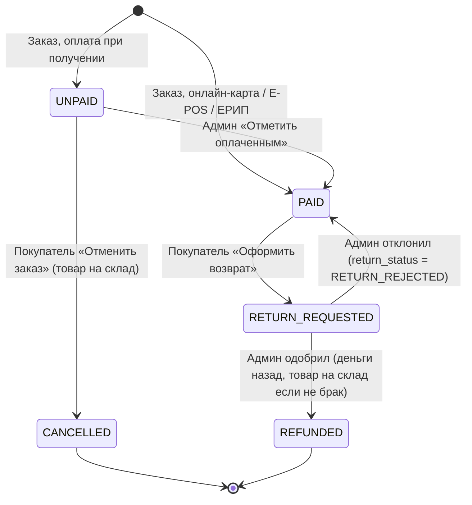
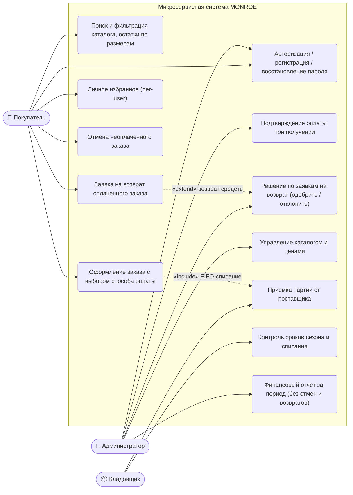
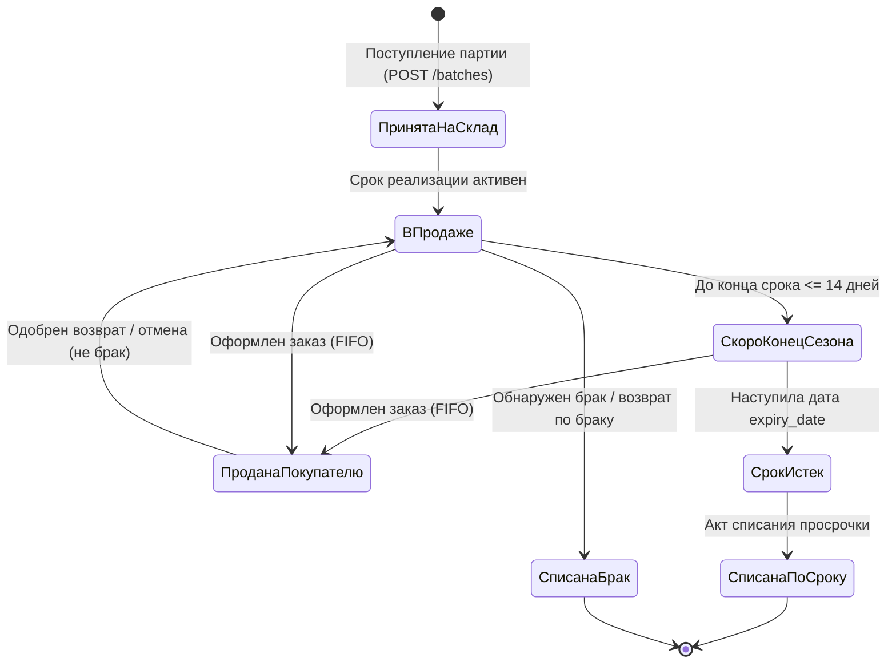

# Спецификация бизнес-требований, анализ рисков и UML-моделирование
## Проект: Автоматизированная микросервисная система бутика брендовой одежды «MONROE»

---

## 1. Бизнес-контекст и цели проекта

### 1.1. Описание бизнеса
**«MONROE»** — мультибрендовый бутик дизайнерской одежды (PATRIZIA PEPE, GIUSEPPE DI MORABITO и др.), работающий в Республике Беларусь. Витрина разделена на женский («ДЛЯ НЕЁ») и мужской («ДЛЯ НЕГО») разделы со своими категориями, размерными сетками и аксессуарами. Все цены указаны в **BYN**.

Товар поступает партиями от разных поставщиков и дистрибьюторов (например, *Tessilform S.p.A. (Флоренция)*, *Morabito Atelier Milano*, *EuroFashion Distribution*), поэтому одна и та же модель одного размера может иметь **разную закупочную себестоимость** в разных партиях.

### 1.2. Ключевые бизнес-проблемы, которые решает система
1. **Разная себестоимость партий одного товара:** без партионного учета (FIFO) невозможно точно посчитать реальную прибыль с каждой проданной вещи.
2. **Сезонное устаревание и списание:** коллекции имеют срок актуальности; просроченные и бракованные единицы нужно корректно списывать с учетом убытков.
3. **Размерная сетка и остатки:** покупателю важно видеть точное количество единиц **каждого размера** (`XS`, `S`, `M`, `L`, `XL`, `XXL`…) на карточке товара и в каталоге.
4. **Оплата и возвраты:** способ оплаты («онлайн картой на сайте» / «картой при получении») не равен факту оплаты. Система должна различать «Оплачен» и «Ожидает оплаты», а при возврате — возвращать деньги тем же способом и корректно учитывать товар на складе.
5. **Прозрачная отчетность:** руководству нужен отчет за период: продано поштучно, выручка, закупочные издержки, потери на списаниях, налог и чистая прибыль. Отменённые и возвращённые заказы не должны искажать выручку.

### 1.3. Роли пользователей (акторы)
* **Покупатель:** каталог, фильтры, личное избранное, корзина, оформление заказа, отмена неоплаченного заказа, заявка на возврат, личный кабинет.
* **Администратор:** управление каталогом и ценами, реестр заказов клиентов, подтверждение оплаты при получении, решение по заявкам на возврат.
* **Кладовщик / мерчандайзер (доменная роль склада):** приемка партий, контроль сроков реализации, списания.

---

## 2. Сценарии использования (Use Cases)

### UC-01: Поиск и просмотр товара покупателем
* **Актор:** Покупатель.
* **Основной поток:**
  1. Открывает витрину, выбирает раздел «ДЛЯ НЕЁ» / «ДЛЯ НЕГО».
  2. Фильтрует по категории, бренду, цвету, размеру, цене; использует поиск.
  3. На карточке видит точные остатки по каждому размеру и открывает детальную страницу товара.

### UC-02: Оформление заказа и выбор способа оплаты
* **Актор:** Покупатель.
* **Предусловие:** нужный размер есть в наличии на складе.
* **Основной поток:**
  1. Добавляет товар нужного размера в корзину, переходит к оформлению.
  2. Указывает адрес доставки и способ оплаты.
  3. `Order Service` запрашивает цену в `Catalog Service` и списывает товар в `Warehouse Service` (FIFO).
  4. Заказ создается со статусом оплаты:
     * **«Онлайн картой на сайте», E-POS, ЕРИП** → `PAID` (деньги получены сразу);
     * **«Картой / наличными при получении»** → `UNPAID` (деньги ещё не у магазина).
  5. Покупатель видит заказ в Личном кабинете → «Текущие заказы».

### UC-03: Личное избранное
* **Актор:** Покупатель.
* **Основной поток:** добавляет/убирает товар в избранное; список хранится **персонально для каждого пользователя** в MySQL (`users_favorites`) и не смешивается с другими аккаунтами.

### UC-04: Авторизация, регистрация и восстановление пароля
* **Актор:** Покупатель / Администратор.
* **Основной поток:** вход по номеру телефона и паролю; регистрация нового аккаунта; «Забыли пароль?» → SMS-код подтверждения → смена пароля в базе.

### UC-05: Отмена неоплаченного заказа
* **Актор:** Покупатель.
* **Предусловие:** заказ в статусе `UNPAID`.
* **Основной поток:** нажимает «Отменить заказ» → статус `CANCELLED`, товар возвращается на склад (`POST /stock/return-item`), деньги не списывались и не возвращаются.

### UC-06: Возврат оплаченного заказа
* **Актор:** Покупатель, Администратор.
* **Предусловие:** заказ в статусе `PAID` (например, клиент оплатил курьеру и через день передумал).
* **Основной поток:**
  1. Покупатель выбирает причину («Не подошел размер», «Не подошел фасон/цвет», «Обнаружен брак») и отправляет заявку → `RETURN_REQUESTED`.
  2. Администратор в «Заказы клиентов» одобряет или отклоняет заявку.
  3. **Одобрено:** деньги возвращаются клиенту тем же способом оплаты → `payment_status = REFUNDED`; если причина **не брак** — товар возвращается в продажу (+1 по размеру); если **брак** — товар в брак-секцию и на витрину не возвращается.
  4. **Отклонено:** заказ остается `PAID`, товар у клиента.
* **Альтернативный поток:** возврат по неоплаченному заказу запрещен — вместо него используется отмена (UC-05).

### UC-07: Подтверждение оплаты при получении
* **Актор:** Администратор.
* **Основной поток:** после доставки и получения денег от курьера нажимает «Отметить оплаченным» → заказ `UNPAID` → `PAID`, фиксируется дата оплаты.

### UC-08: Управление каталогом
* **Актор:** Администратор.
* **Основной поток:** добавление новых моделей, изменение розничной цены, удаление позиций; изменения сразу видны покупателям.

### UC-09: Приемка новой партии товара от поставщика
* **Актор:** Кладовщик / Мерчандайзер.
* **Основной поток:** регистрирует партию (модель, размер, поставщик, количество, закупочная цена за шт., срок окончания сезонной реализации); остатки размера обновляются.

### UC-10: Контроль сроков и списание товара
* **Актор:** Кладовщик / Мерчандайзер.
* **Основной поток:** система выделяет партии «скоро конец сезона (≤ 14 дней)» и «срок истек»; кладовщик списывает просрочку или брак с фиксацией убытка по закупочной цене.

### UC-11: Финансовый отчет за период
* **Актор:** Владелец бренда / Менеджер.
* **Основной поток:** `Analytics Service` опрашивает `Order`, `Warehouse`, `Catalog`; формирует поштучную и сводную прибыль, налоги и списания. Заказы `CANCELLED` и `REFUNDED` **исключаются из выручки** (деньги не остались у магазина).

---

## 3. Статусы заказа (модель жизненного цикла)

| Поле | Значения | Смысл |
|:---|:---|:---|
| `payment_status` | `UNPAID` | Оформлен, оплата ожидается при получении |
| | `PAID` | Деньги получены (онлайн сразу либо админ подтвердил оплату курьеру) |
| | `REFUNDED` | Деньги возвращены клиенту по одобренному возврату |
| | `CANCELLED` | Отменён до оплаты, товар вернулся на склад |
| `return_status` | `NONE` / `RETURN_REQUESTED` / `RETURN_APPROVED` / `RETURN_REJECTED` | Статус заявки на возврат |

---

## 4. UML-диаграммы

### 4.1. Диаграмма вариантов использования (Use Case)

### 4.2. Диаграмма состояний единицы товара в партии (Statechart)

---

## 5. Реестр рисков проекта

1. **Риск потери маржинальности при росте закупочных цен:** партионный FIFO-учет сохраняет историческую цену каждой поставки.
2. **Риск накопления сезонного неликвида:** `/alerts/expiring` подсвечивает партии с остатком срока ≤ 14 дней.
3. **Риск возврата денег по неоплаченному заказу:** возврат разрешен только для `PAID`; для `UNPAID` предусмотрена отмена без движения денег.
4. **Риск рассинхронизации склада при возврате/отмене:** возврат товара на склад выполняется отдельным запросом `POST /stock/return-item`; брак не возвращается в продажу.
5. **Риск искажения выручки отменами и возвратами:** аналитика исключает заказы `CANCELLED` и `REFUNDED` из выручки и прибыли.
6. **Риск смешивания личных данных покупателей:** избранное хранится per-user (`users_favorites`), роли покупатель/админ строго разделены.
7. **Риск отказа отдельного микросервиса:** независимые процессы (`8001`–`8004`), health-check и статус-панель в шапке интерфейса.

---

## 6. Модель данных (MySQL, Open Server)

База **`monroe_db`** на MySQL 8.4 (`127.0.1.31:3306`, пользователь `root`, пароль пустой). JSON-файлы сервисов используются как fallback и синхронизируются с MySQL.

| Таблица | Назначение |
|:---|:---|
| `users` | Аккаунты покупателей и администратора (телефон, пароль, роль) |
| `user_addresses` | Адреса доставки покупателей |
| `products` | Каталог моделей (бренд, пол, категория, размеры, цена BYN) |
| `orders` | Заказы + `payment_status`, `paid_at`, `refunded_at`, `return_status`, `return_reason` |
| `order_returns` | Журнал заявок на возврат и решений администратора |
| `users_favorites` | Личное избранное каждого покупателя |
